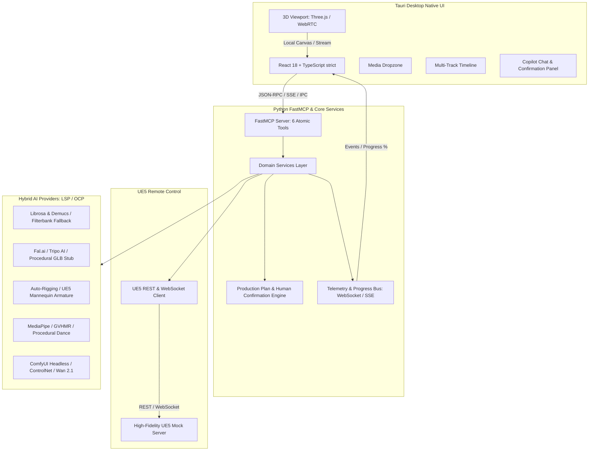

# Project: IANIMATION - Orquestador de Animación 3D e IA

## Architecture

IANIMATION is structured according to Clean Architecture and SOLID principles, ensuring complete decoupling between the UI layer (Tauri/React), the orchestration and tool layer (FastMCP), the 3D game engine bridge (Unreal Engine 5 Remote Control & Mock Server), and the generative AI execution engines.



---

## Code Layout

The project root is organized into clean module boundaries:

```
e:\Disco F\Dev\IANIMATION\
├── backend/                        # Python Core, FastMCP, AI & UE5 Bridge
│   ├── core/                       # Shared models, telemetry, cache, config
│   │   ├── __init__.py
│   │   ├── config.py               # App configuration & environment variables
│   │   ├── models.py               # Pydantic v2 core data types (Zero-Any)
│   │   ├── telemetry.py            # Event bus, progress reporting (SSE/WS)
│   │   └── cache.py                # Content-addressable storage (SHA-256 CAS)
│   ├── ue5/                        # Unreal Engine 5 communication
│   │   ├── __init__.py
│   │   ├── client.py               # REST and WebSocket Remote Control client
│   │   ├── mock_server.py          # High-fidelity offline UE5 emulator
│   │   ├── camera.py               # CineCameraActor choreography & tracking
│   │   ├── lighting.py             # Lumen lighting rig (Directional, Sky, 3-Point)
│   │   ├── materials.py            # Dynamic PBR material assignment
│   │   └── mrq.py                  # Movie Render Queue triggers & job tracking
│   ├── ai/                         # Hybrid AI pipelines (LSP interfaces & adapters)
│   │   ├── __init__.py
│   │   ├── base.py                 # Abstract BaseAIProvider & Registry
│   │   ├── audio.py                # Librosa/Demucs tempo, beats & stem separation
│   │   ├── image_to_3d.py          # Fal/Tripo Cloud adapters & procedural GLB stub
│   │   ├── auto_rig.py             # Skeletal detection & UE5 mannequin rigging
│   │   ├── mocap.py                # MediaPipe/GVHMR 3D mocap extraction & dance stub
│   │   ├── neural.py               # Headless ComfyUI client (ControlNet/Wan)
│   │   └── async_engine.py         # Async task supervisor & cancellation tokens
│   ├── mcp/                        # FastMCP Server & Copilot
│   │   ├── __init__.py
│   │   ├── server.py               # FastMCP instance & tool registrations
│   │   ├── tools.py                # 6 atomic tools (strict JSON Schema)
│   │   └── plan_engine.py          # Human-in-the-Loop plan proposal & confirm gates
│   └── main.py                     # Entry point for backend services
├── src-tauri/                      # Tauri v2 Rust Core
│   ├── Cargo.toml
│   ├── tauri.conf.json
│   └── src/
│       └── main.rs                 # Native windowing, IPC commands, life-cycle
├── src/                            # React 18 + TypeScript Frontend (strict: true)
│   ├── index.html
│   ├── package.json
│   ├── tsconfig.json               # strict: true, noImplicitAny: true
│   ├── vite.config.ts
│   ├── components/
│   │   ├── dropzone/               # Media drag & drop (audio, image, video)
│   │   ├── timeline/               # Multi-track timeline, waveforms, beat ticks
│   │   ├── viewport/               # 3D viewport (Three.js WebGL & Pixel Streaming)
│   │   ├── copilot/                # Copilot chat, plan cards, approval buttons
│   │   └── common/                 # Header, modal, progress bars, telemetry stream
│   ├── types/                      # Zod schemas & TypeScript type definitions
│   ├── store/                      # Zustand state management
│   └── services/                   # FastMCP client, WebSocket / SSE listeners
├── tests/                          # Automated Test Suites
│   ├── backend/                    # pytest unit & integration tests
│   │   ├── test_models.py
│   │   ├── test_ue5_bridge.py
│   │   ├── test_ai_pipelines.py
│   │   ├── test_fastmcp_server.py
│   │   └── test_plan_engine.py
│   ├── frontend/                   # Vitest component unit tests
│   │   ├── Dropzone.test.tsx
│   │   ├── Timeline.test.tsx
│   │   ├── Viewport.test.tsx
│   │   └── Copilot.test.tsx
│   └── e2e/                        # Comprehensive test cases (Tiers 1-4)
├── scripts/
│   └── verify_pipeline.py          # 9-phase end-to-end simulation CLI script
├── GEMINI.md                       # Engineering guidelines & zero-any policy
├── PROJECT_STATUS.md               # Continuous project progress log
└── README.md                       # Project overview, tool index & documentation
```

---

## Feature Inventory

Every requirement and architectural capability is enumerated and mapped to an implementation milestone:

| # | Feature | Description | Milestone | Source |
|---|---------|-------------|-----------|--------|
| 1 | F-CORE-01 | Pydantic v2 domain models for all inputs, outputs, and intermediate assets | M1 | Survey / GEMINI.md |
| 2 | F-CORE-02 | Telemetry & Progress event bus with WebSocket/SSE emitters | M1 | R4 / Survey |
| 3 | F-CORE-03 | Content-addressable storage (SHA-256 CAS) asset cache for AI and 3D files | M1 | Survey / Architecture |
| 4 | F-CORE-04 | Central application configuration and environment variable resolver | M1 | GEMINI.md |
| 5 | F-UE5-01 | UE5 Remote Control REST client (`/remote/object/call`, `/remote/object/property`) | M2 | R1 / Acceptance |
| 6 | F-UE5-02 | UE5 Remote Control WebSocket client (`/remote/protocol`) with RPC & event subscriptions | M2 | R1 / Acceptance |
| 7 | F-UE5-03 | High-fidelity Python UE5 Mock Server emulating ports 30010 and 30020 | M2 | R1 / Acceptance |
| 8 | F-UE5-04 | Dynamic runtime asset loading for `.glb` and `.fbx` meshes & skeletal armatures | M2 | R1 / Acceptance |
| 9 | F-UE5-05 | Programmatic PBR material assignment (albedo, normal, roughness, metallic) | M2 | R1 / Acceptance |
| 10 | F-UE5-06 | Lumen lighting rig configuration (Directional, SkyLight, 3-point key/fill/rim, PostProcess) | M2 | R1 / Acceptance |
| 11 | F-UE5-07 | CineCameraActor choreography and keyframe tracking synced to audio beats | M2 | R1 / Acceptance |
| 12 | F-UE5-08 | Movie Render Queue (MRQ) job scheduling, progress ticker, and export capture | M2 | R1 / Acceptance |
| 13 | F-AI-01 | BaseAIProvider abstract interfaces with strict Pydantic v2 schemas (LSP/OCP) | M3 | R2 / GEMINI.md |
| 14 | F-AI-02 | Audio tempo, BPM, beat timestamps, and normalized onset curve extraction (Librosa) | M3 | R2 / Acceptance |
| 15 | F-AI-03 | Audio 4-stem separation (`vocals`, `drums`, `bass`, `other`) with Demucs and Scipy filterbank fallback | M3 | R2 / Acceptance |
| 16 | F-AI-04 | Image-to-3D Cloud adapters (Fal.ai, Tripo AI, Replicate) | M3 | R2 / Acceptance |
| 17 | F-AI-05 | Image-to-3D Procedural PBR GLB generator stub for offline CPU execution | M3 | R2 / Acceptance |
| 18 | F-AI-06 | Auto-Rigging engine targeting UE5 standard bipedal skeletal hierarchy | M3 | R2 / Acceptance |
| 19 | F-AI-07 | Mocap & Rotoscopy: Video background removal via Rembg alpha matting | M3 | R2 / Acceptance |
| 20 | F-AI-08 | Mocap & Rotoscopy: MediaPipe 3D pose extraction and procedural BPM dance loop generator | M3 | R2 / Acceptance |
| 21 | F-AI-09 | Neural Enhancer: Headless ComfyUI REST/WebSocket client (ControlNet Depth/Normal, Wan/AnimateDiff) | M3 | R2 / Acceptance |
| 22 | F-AI-10 | Async non-blocking task supervisor with cooperative cancellation tokens | M3 | R2 / Acceptance |
| 23 | F-MCP-01 | FastMCP server implementation exposing 6 atomic tools with strict JSON Schemas | M4 | R4 / Acceptance |
| 24 | F-MCP-02 | Dual invocation architecture (FastMCP client vs direct Python programmatic call) | M4 | R4 / Acceptance |
| 25 | F-MCP-03 | Production Plan generation (`ProductionPlan`, `PlanStep`) with risk grading | M4 | R4 / Acceptance |
| 26 | F-MCP-04 | Human-in-the-Loop explicit confirmation gate for heavy/destructive operations | M4 | R4 / Acceptance |
| 27 | F-MCP-05 | Real-time telemetry streaming to frontend via WebSocket / SSE endpoints | M4 | R4 / Acceptance |
| 28 | F-UI-01 | Tauri v2 project setup (Rust core + React 18 / Vite / TypeScript strict: true) | M5 | R3 / Acceptance |
| 29 | F-UI-02 | Drag-and-Drop media dropzone (images, audio `.wav`/`.mp3`, video `.mp4`) with card tray | M5 | R3 / Acceptance |
| 30 | F-UI-03 | Multi-track audiovisual timeline with waveform rendering, beat markers, and playhead | M5 | R3 / Acceptance |
| 31 | F-UI-04 | 3D Viewport with Three.js WebGL offline `.glb` preview | M5 | R3 / Acceptance |
| 32 | F-UI-05 | 3D Viewport WebRTC Pixel Streaming mock/embed interface | M5 | R3 / Acceptance |
| 33 | F-UI-06 | Copilot chat console with step-by-step production plan cards & human approval buttons | M5 | R3 / Acceptance |
| 34 | F-UI-07 | Intermediate asset cards (stems, 3D mesh, mocap clip, rendered video) in UI | M5 | R3 / Acceptance |
| 35 | F-UI-08 | Frontend Zustand store and Zod validation schemas satisfying Zero-Any policy | M5 | GEMINI.md |
| 36 | F-TEST-01 | Automated backend test suite with `pytest` covering all core modules, UE5, and AI | M6 | Acceptance |
| 37 | F-TEST-02 | Automated frontend component test suite with Vitest / React Testing Library | M6 | Acceptance |
| 38 | F-TEST-03 | End-to-end 9-phase simulation CLI script `verify_pipeline.py` with synthetic fixtures | M6 | Acceptance |
| 39 | F-DOC-01 | Comprehensive `README.md` and MCP tool documentation catalog with JSON schemas | M6 | GEMINI.md |
| 40 | F-E2E-01 | Pass 100% of the opaque-box E2E test suite (Tiers 1-4) published in `TEST_READY.md` | M7 | Final Milestone |
| 41 | F-E2E-02 | Adversarial coverage hardening (Tier 5) with Challenger stress testing | M7 | Final Milestone |

---

## Milestones

| # | Name | Scope | Dependencies | Status |
|---|------|-------|-------------|--------|
| M1 | Core Models & Telemetry | Domain models, telemetry bus, CAS cache, app config (`backend/core`) | none | DONE |
| M2 | UE5 Bridge & Mock Server | REST/WS client, high-fidelity mock server, camera, lighting, MRQ (`backend/ue5`) | M1 | IN_PROGRESS |
| M3 | Hybrid AI Pipelines | Audio, 3D, Rigging, Mocap, Neural enhancer, async supervisor (`backend/ai`) | M1 | PLANNED |
| M4 | FastMCP Server & Copilot | 6 atomic tools, dual invocation, plan generator, confirm gates (`backend/mcp`) | M2, M3 | PLANNED |
| M5 | Tauri Native Desktop App | Rust backend, React/TS frontend, Dropzone, Timeline, Viewport, Copilot UI | M1, M4 | PLANNED |
| M6 | Integration & Verification CLI | `pytest` suites, Vitest tests, `verify_pipeline.py` CLI script, documentation | M1, M2, M3, M4, M5 | PLANNED |
| M7 | Final Milestone: 100% E2E Pass & Hardening | Phase 1: Pass 100% E2E tests (Tiers 1-4). Phase 2: Tier 5 Adversarial Hardening | M6, TEST_READY.md | PLANNED |

*Parallel Track*:
- **E2E Testing Track**: Dispatched concurrently to build `TEST_INFRA.md` and E2E opaque-box test suites (Tiers 1-4), publishing `TEST_READY.md`.

---

## Interface Contracts

### 1. FastMCP Atomic Tools (`backend/mcp/tools.py`)

- `analyze_audio(audio_path: str, separate_stems: bool = True) -> AudioAnalysisResult`
  - Input: Path to valid `.wav` or `.mp3`.
  - Output: `bpm: float`, `duration_seconds: float`, `beat_timestamps: List[float]`, `onset_envelope: List[float]`, `stems: Optional[Dict[str, str]]`.
- `image_to_3d(image_path: str, provider: str = "auto", texture_resolution: int = 1024) -> ImageTo3DResult`
  - Input: Path to image `.png` or `.jpg`.
  - Output: `mesh_path: str (.glb)`, `textures: PBRTextureSet`, `vertex_count: int`, `cached: bool`.
- `auto_rig(mesh_path: str, skeleton_type: str = "ue5_mannequin") -> AutoRigResult`
  - Input: Path to `.glb` or `.fbx` mesh.
  - Output: `rigged_mesh_path: str`, `bone_count: int`, `hierarchy: List[str]`.
- `extract_mocap(video_path: str, target_fps: int = 30) -> MocapResult`
  - Input: Path to dance video `.mp4`.
  - Output: `animation_path: str (.glb/.fbx)`, `frame_count: int`, `fps: int`, `duration: float`.
- `build_ue5_scene(scene_config: SceneConfig) -> SceneBuildResult`
  - Input: `mesh_path`, `animation_path`, `lighting_preset: str`, `camera_choreography: List[CameraKeyframe]`.
  - Output: `success: bool`, `actor_ids: List[str]`, `scene_path: str`.
- `render_video(scene_path: str, output_path: str, fps: int = 60, resolution: str = "1920x1080") -> RenderResult`
  - Input: Scene descriptor, destination path, format settings.
  - Output: `video_path: str (.mp4)`, `frame_count: int`, `elapsed_seconds: float`.

### 2. UE5 Remote Control Protocol (`backend/ue5/client.py`)

- REST: `PUT http://localhost:30010/remote/object/call`
  - Payload: `{"objectPath": str, "functionName": str, "parameters": dict, "generateTransaction": bool}`
  - Response: `{"status": 200, "result": dict}`
- WebSocket: `ws://localhost:30020/remote/protocol`
  - Send: `{"MessageName": "http", "Parameters": {"Url": "/remote/object/call", "Verb": "PUT", "Body": {...}}}`
  - Event Subscription: `{"MessageName": "subscribe", "Parameters": {"Path": "/remote/object/property", ...}}`

### 3. Telemetry Event Contract (`backend/core/telemetry.py`)

```typescript
// Frontend Zod Schema
export const TelemetryEventSchema = z.discriminatedUnion("type", [
  z.object({
    type: z.literal("progress"),
    stage: z.string(),
    percentage: z.number().min(0).max(100),
    message: z.string(),
    timestamp: z.string(),
  }),
  z.object({
    type: z.literal("plan_proposal"),
    plan_id: z.string(),
    steps: z.array(PlanStepSchema),
    status: z.enum(["proposed", "approved", "rejected", "in_progress", "completed"]),
  }),
  z.object({
    type: z.literal("asset_ready"),
    asset_id: z.string(),
    asset_type: z.enum(["audio_stems", "mesh_3d", "rigged_mesh", "mocap", "render_video"]),
    file_path: z.string(),
  }),
  z.object({
    type: z.literal("log"),
    level: z.enum(["info", "warning", "error"]),
    message: z.string(),
    timestamp: z.string(),
  }),
]);
```
