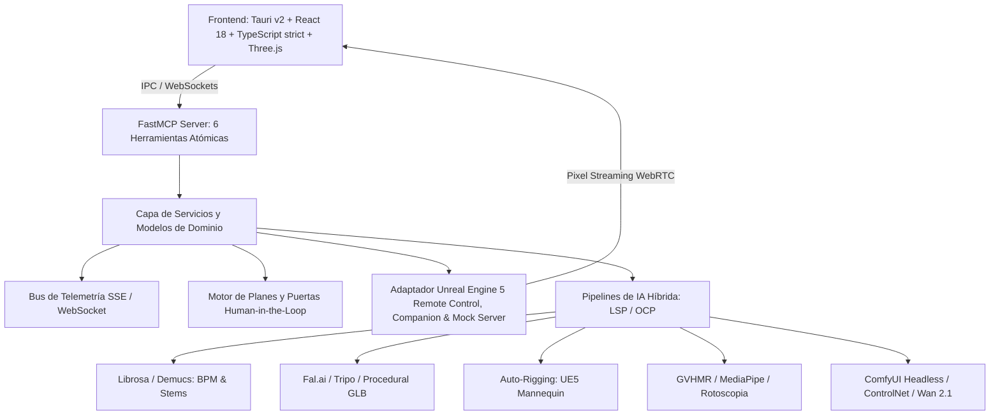

# IANIMATION - Orquestador de Animación 3D e IA Generativa

IANIMATION es una aplicación de escritorio nativa de alta fidelidad que automatiza la creación de escenas, personajes 3D, auto-rigging, captura de movimiento y renderizado cinemático audiovisual controlando **Unreal Engine 5** mediante **FastMCP (Model Context Protocol)** e integrando pipelines híbridos de inteligencia artificial (locales y cloud).

---

## Arquitectura del Sistema (Clean Architecture & SOLID)



---

## Catálogo de Herramientas FastMCP (Model Context Protocol)

El servidor FastMCP expone 6 herramientas atómicas con esquemas de validación estrictos (Pydantic v2 / Zero-Any):

| Herramienta | Parámetros Principales | Salida | Descripción |
| :--- | :--- | :--- | :--- |
| `analyze_audio` | `audio_path`, `separate_stems`, `tempo_hint` | `AudioAnalysisResult` | Detecta BPM, timestamps de beats y separa stems (voz, batería, bajo). |
| `image_to_3d` | `image_path`, `provider`, `output_path` | `ImageTo3DResult` | Convierte una imagen 2D en una malla 3D estructurada (`.glb`) con texturas PBR. |
| `auto_rig` | `mesh_path`, `skeleton_type`, `output_path` | `AutoRigResult` | Inyecta un esqueleto estándar (UE5 Mannequin) y calcula pesos de deformación. |
| `extract_mocap` | `video_path`, `target_fps`, `output_path` | `MocapResult` | Extrae animación bípeda 3D desde video y elimina el fondo mediante rotoscopia. |
| `build_ue5_scene` | `scene_config` (`mesh_path`, `camera_choreography`, `lighting_preset`) | `SceneBuildResult` | Construye la escena en UE5, posiciona actores, aplica Lumen y coreografía cámaras. |
| `render_video` | `scene_path`, `output_path`, `fps`, `resolution` | `RenderResult` | Renderiza el video final cinemático con Movie Render Queue (MRQ). |

---

## Especificación Formal de Esquemas JSON Schema de Herramientas FastMCP

Cada herramienta implementa esquemas estrictos validados en tiempo de ejecución conforme a la especificación Model Context Protocol:

### 1. `analyze_audio`

#### Parámetros de Entrada (`parameters`)
```json
{
  "$schema": "http://json-schema.org/draft-07/schema#",
  "title": "AnalyzeAudioInput",
  "type": "object",
  "properties": {
    "audio_path": {
      "type": "string",
      "minLength": 1,
      "description": "Ruta absoluta o relativa al archivo de audio (.wav, .mp3, .ogg, .flac)"
    },
    "separate_stems": {
      "type": "boolean",
      "default": false,
      "description": "Separación de pistas en 4 stems (vocals, drums, bass, other)"
    },
    "tempo_hint": {
      "type": ["number", "null"],
      "minimum": 30.0,
      "maximum": 300.0,
      "default": null,
      "description": "Estimación previa opcional de BPM para guiar el detector"
    }
  },
  "required": ["audio_path"],
  "additionalProperties": false
}
```

#### Esquema de Salida (`AudioAnalysisResult`)
```json
{
  "$schema": "http://json-schema.org/draft-07/schema#",
  "title": "AudioAnalysisResult",
  "type": "object",
  "properties": {
    "bpm": { "type": "number", "minimum": 0.0, "description": "Tempo detectado en BPM" },
    "duration_seconds": { "type": "number", "minimum": 0.0, "description": "Duración total en segundos" },
    "beat_timestamps": {
      "type": "array",
      "items": { "type": "number" },
      "description": "Timestamps cronológicos de cada beat en segundos"
    },
    "onset_envelope": {
      "type": "array",
      "items": { "type": "number" },
      "description": "Curva de energía musical y ataques de transitorios normalizada"
    },
    "stems": {
      "type": ["object", "null"],
      "additionalProperties": { "type": "string" },
      "description": "Mapeo de nombres de stems a rutas de archivos generados"
    },
    "time_signature": { "type": "string", "default": "4/4" },
    "danceability": { "type": "number", "minimum": 0.0, "maximum": 1.0 }
  },
  "required": ["bpm", "duration_seconds", "beat_timestamps"],
  "additionalProperties": false
}
```

---

### 2. `image_to_3d`

#### Parámetros de Entrada (`parameters`)
```json
{
  "$schema": "http://json-schema.org/draft-07/schema#",
  "title": "ImageTo3DInput",
  "type": "object",
  "properties": {
    "image_path": {
      "type": "string",
      "minLength": 1,
      "description": "Ruta a la imagen de concepto 2D (.png, .jpg, .webp)"
    },
    "provider": {
      "type": "string",
      "enum": ["auto", "fal", "tripo", "replicate", "procedural_cpu", "procedural_stub"],
      "default": "auto",
      "description": "Proveedor de inferencia 3D o generador procedural local"
    },
    "output_path": {
      "type": ["string", "null"],
      "default": null,
      "description": "Ruta destino del archivo .glb generado"
    }
  },
  "required": ["image_path"],
  "additionalProperties": false
}
```

#### Esquema de Salida (`ImageTo3DResult`)
```json
{
  "$schema": "http://json-schema.org/draft-07/schema#",
  "title": "ImageTo3DResult",
  "type": "object",
  "properties": {
    "mesh_path": { "type": "string", "minLength": 1 },
    "textures": {
      "type": "object",
      "properties": {
        "albedo_path": { "type": ["string", "null"] },
        "normal_path": { "type": ["string", "null"] },
        "roughness_path": { "type": ["string", "null"] },
        "metallic_path": { "type": ["string", "null"] },
        "resolution": { "type": "integer", "default": 1024 }
      }
    },
    "vertex_count": { "type": "integer", "minimum": 0 },
    "polygon_count": { "type": "integer", "minimum": 0 },
    "cached": { "type": "boolean" },
    "mesh_format": { "type": "string", "enum": ["glb", "gltf", "fbx", "obj", "usd"] },
    "provider_used": { "type": "string" },
    "generation_time_seconds": { "type": "number", "minimum": 0.0 }
  },
  "required": ["mesh_path", "vertex_count"],
  "additionalProperties": false
}
```

---

### 3. `auto_rig`

#### Parámetros de Entrada (`parameters`)
```json
{
  "$schema": "http://json-schema.org/draft-07/schema#",
  "title": "AutoRigInput",
  "type": "object",
  "properties": {
    "mesh_path": {
      "type": "string",
      "minLength": 1,
      "description": "Ruta a la malla 3D estática (.glb o .fbx)"
    },
    "skeleton_type": {
      "type": "string",
      "enum": ["ue5_mannequin", "mixamo"],
      "default": "ue5_mannequin",
      "description": "Jerarquía esquelética estándar destino"
    },
    "output_path": {
      "type": ["string", "null"],
      "default": null,
      "description": "Ruta destino de la malla esquelética armada"
    }
  },
  "required": ["mesh_path"],
  "additionalProperties": false
}
```

#### Esquema de Salida (`AutoRigResult`)
```json
{
  "$schema": "http://json-schema.org/draft-07/schema#",
  "title": "AutoRigResult",
  "type": "object",
  "properties": {
    "rigged_mesh_path": { "type": "string", "minLength": 1 },
    "bone_count": { "type": "integer", "minimum": 1 },
    "hierarchy": {
      "type": "array",
      "items": { "type": "string" },
      "description": "Nombres topológicos de los huesos ordenados desde la raíz"
    },
    "skeleton_type": { "type": "string", "default": "ue5_mannequin" },
    "success": { "type": "boolean", "default": true }
  },
  "required": ["rigged_mesh_path", "bone_count", "hierarchy"],
  "additionalProperties": false
}
```

---

### 4. `extract_mocap`

#### Parámetros de Entrada (`parameters`)
```json
{
  "$schema": "http://json-schema.org/draft-07/schema#",
  "title": "ExtractMocapInput",
  "type": "object",
  "properties": {
    "video_path": {
      "type": "string",
      "minLength": 1,
      "description": "Ruta al video de referencia de baile o movimiento (.mp4, .mov)"
    },
    "target_fps": {
      "type": "integer",
      "minimum": 1,
      "maximum": 120,
      "default": 30,
      "description": "Tasa de muestreo de animación en FPS"
    },
    "output_path": {
      "type": ["string", "null"],
      "default": null,
      "description": "Ruta destino de la pista de animación exportada (.glb)"
    }
  },
  "required": ["video_path"],
  "additionalProperties": false
}
```

#### Esquema de Salida (`MocapResult`)
```json
{
  "$schema": "http://json-schema.org/draft-07/schema#",
  "title": "MocapResult",
  "type": "object",
  "properties": {
    "animation_path": { "type": "string", "minLength": 1 },
    "frame_count": { "type": "integer", "minimum": 0 },
    "fps": { "type": "integer", "default": 30 },
    "duration": { "type": "number", "minimum": 0.0 },
    "tracked_joints_count": { "type": "integer", "default": 33 }
  },
  "required": ["animation_path", "frame_count", "duration"],
  "additionalProperties": false
}
```

---

### 5. `build_ue5_scene`

#### Parámetros de Entrada (`parameters`)
```json
{
  "$schema": "http://json-schema.org/draft-07/schema#",
  "title": "BuildUE5SceneInput",
  "type": "object",
  "properties": {
    "scene_config": {
      "type": "object",
      "properties": {
        "mesh_path": { "type": "string", "minLength": 1 },
        "animation_path": { "type": ["string", "null"], "default": null },
        "lighting_preset": { "type": "string", "default": "cinematic_three_point" },
        "camera_choreography": {
          "type": "array",
          "items": {
            "type": "object",
            "properties": {
              "time": { "type": "number", "minimum": 0.0 },
              "x": { "type": "number" },
              "y": { "type": "number" },
              "z": { "type": "number" },
              "pitch": { "type": "number" },
              "yaw": { "type": "number" },
              "roll": { "type": "number", "default": 0.0 },
              "fov": { "type": "number", "minimum": 10.0, "maximum": 120.0, "default": 60.0 }
            },
            "required": ["time", "x", "y", "z", "pitch", "yaw"]
          }
        },
        "level_name": { "type": "string", "default": "Stage_Main" },
        "lumen_enabled": { "type": "boolean", "default": true }
      },
      "required": ["mesh_path"]
    }
  },
  "required": ["scene_config"],
  "additionalProperties": false
}
```

#### Esquema de Salida (`SceneBuildResult`)
```json
{
  "$schema": "http://json-schema.org/draft-07/schema#",
  "title": "SceneBuildResult",
  "type": "object",
  "properties": {
    "success": { "type": "boolean" },
    "actor_ids": { "type": "array", "items": { "type": "string" } },
    "scene_path": { "type": "string", "minLength": 1 },
    "camera_actor_id": { "type": ["string", "null"] },
    "character_actor_id": { "type": ["string", "null"] },
    "message": { "type": "string" }
  },
  "required": ["success", "actor_ids", "scene_path"],
  "additionalProperties": false
}
```

---

### 6. `render_video`

#### Parámetros de Entrada (`parameters`)
```json
{
  "$schema": "http://json-schema.org/draft-07/schema#",
  "title": "RenderVideoInput",
  "type": "object",
  "properties": {
    "scene_path": { "type": "string", "minLength": 1, "description": "Ruta al Level Sequence" },
    "output_path": { "type": "string", "minLength": 1, "description": "Ruta destino del video .mp4" },
    "fps": { "type": "integer", "minimum": 1, "maximum": 240, "default": 30 },
    "resolution": { "type": "string", "pattern": "^\\d+x\\d+$", "default": "1280x720" },
    "warmup_frames": { "type": "integer", "minimum": 0, "default": 15 },
    "anti_aliasing_samples": { "type": "integer", "minimum": 1, "maximum": 64, "default": 8 }
  },
  "required": ["scene_path", "output_path"],
  "additionalProperties": false
}
```

#### Esquema de Salida (`RenderResult`)
```json
{
  "$schema": "http://json-schema.org/draft-07/schema#",
  "title": "RenderResult",
  "type": "object",
  "properties": {
    "video_path": { "type": "string", "minLength": 1 },
    "frame_count": { "type": "integer", "minimum": 0 },
    "elapsed_seconds": { "type": "number", "minimum": 0.0 },
    "fps": { "type": "integer", "default": 30 },
    "resolution": { "type": "string", "default": "1280x720" },
    "file_size_bytes": { "type": "integer", "minimum": 0 },
    "success": { "type": "boolean", "default": true }
  },
  "required": ["video_path", "frame_count", "elapsed_seconds"],
  "additionalProperties": false
}
```

---

## Ejemplos Concretos de Invocación JSON-RPC 2.0 (Model Context Protocol)

Los clientes MCP (Claude Desktop, Antigravity IDE, Taurus UI) se comunican con el servidor mediante el protocolo estándar JSON-RPC 2.0 a través de `stdio` o `SSE`.

### Invocación 1: `analyze_audio`

**Solicitud JSON-RPC (Request):**
```json
{
  "jsonrpc": "2.0",
  "id": "call_audio_001",
  "method": "tools/call",
  "params": {
    "name": "analyze_audio",
    "arguments": {
      "audio_path": "e:/Disco F/Dev/IANIMATION/inputs/cyberpunk_beat.wav",
      "separate_stems": true,
      "tempo_hint": 128.0
    }
  }
}
```

**Respuesta JSON-RPC (Response):**
```json
{
  "jsonrpc": "2.0",
  "id": "call_audio_001",
  "result": {
    "bpm": 128.0,
    "duration_seconds": 10.0,
    "beat_timestamps": [0.0, 0.468, 0.937, 1.406, 1.875, 2.343, 2.812, 3.281, 3.75, 4.218],
    "onset_envelope": [0.12, 0.84, 0.96, 0.31, 0.72, 0.95, 0.88, 0.41, 0.91, 1.0],
    "stems": {
      "vocals": "outputs/stems/vocals.wav",
      "drums": "outputs/stems/drums.wav",
      "bass": "outputs/stems/bass.wav",
      "other": "outputs/stems/other.wav"
    },
    "time_signature": "4/4",
    "danceability": 0.88
  }
}
```

---

### Invocación 2: `image_to_3d`

**Solicitud JSON-RPC (Request):**
```json
{
  "jsonrpc": "2.0",
  "id": "call_img3d_002",
  "method": "tools/call",
  "params": {
    "name": "image_to_3d",
    "arguments": {
      "image_path": "inputs/cyber_dancer.png",
      "provider": "auto",
      "output_path": "outputs/cyber_dancer.glb"
    }
  }
}
```

**Respuesta JSON-RPC (Response):**
```json
{
  "jsonrpc": "2.0",
  "id": "call_img3d_002",
  "result": {
    "mesh_path": "outputs/cyber_dancer.glb",
    "textures": {
      "albedo_path": "outputs/textures/cyber_dancer_albedo.png",
      "normal_path": "outputs/textures/cyber_dancer_normal.png",
      "roughness_path": "outputs/textures/cyber_dancer_roughness.png",
      "metallic_path": "outputs/textures/cyber_dancer_metallic.png",
      "resolution": 1024
    },
    "vertex_count": 8420,
    "polygon_count": 12680,
    "cached": false,
    "mesh_format": "glb",
    "provider_used": "procedural_cpu",
    "generation_time_seconds": 1.45
  }
}
```

---

### Invocación 3: `auto_rig`

**Solicitud JSON-RPC (Request):**
```json
{
  "jsonrpc": "2.0",
  "id": "call_rig_003",
  "method": "tools/call",
  "params": {
    "name": "auto_rig",
    "arguments": {
      "mesh_path": "outputs/cyber_dancer.glb",
      "skeleton_type": "ue5_mannequin",
      "output_path": "outputs/cyber_dancer_rigged.glb"
    }
  }
}
```

**Respuesta JSON-RPC (Response):**
```json
{
  "jsonrpc": "2.0",
  "id": "call_rig_003",
  "result": {
    "rigged_mesh_path": "outputs/cyber_dancer_rigged.glb",
    "bone_count": 21,
    "hierarchy": [
      "root", "pelvis", "spine_01", "spine_02", "neck_01", "head",
      "clavicle_l", "upperarm_l", "lowerarm_l", "hand_l",
      "clavicle_r", "upperarm_r", "lowerarm_r", "hand_r",
      "thigh_l", "calf_l", "foot_l",
      "thigh_r", "calf_r", "foot_r"
    ],
    "skeleton_type": "ue5_mannequin",
    "success": true
  }
}
```

---

### Invocación 4: `extract_mocap`

**Solicitud JSON-RPC (Request):**
```json
{
  "jsonrpc": "2.0",
  "id": "call_mocap_004",
  "method": "tools/call",
  "params": {
    "name": "extract_mocap",
    "arguments": {
      "video_path": "inputs/dance_reference.mp4",
      "target_fps": 30,
      "output_path": "outputs/dance_mocap.glb"
    }
  }
}
```

**Respuesta JSON-RPC (Response):**
```json
{
  "jsonrpc": "2.0",
  "id": "call_mocap_004",
  "result": {
    "animation_path": "outputs/dance_mocap.glb",
    "frame_count": 90,
    "fps": 30,
    "duration": 3.0,
    "tracked_joints_count": 33
  }
}
```

---

### Invocación 5: `build_ue5_scene`

**Solicitud JSON-RPC (Request):**
```json
{
  "jsonrpc": "2.0",
  "id": "call_ue5_005",
  "method": "tools/call",
  "params": {
    "name": "build_ue5_scene",
    "arguments": {
      "scene_config": {
        "mesh_path": "outputs/cyber_dancer_rigged.glb",
        "animation_path": "outputs/dance_mocap.glb",
        "lighting_preset": "cyberpunk_neon",
        "camera_choreography": [
          { "time": 0.0, "x": 0.0, "y": -400.0, "z": 120.0, "pitch": -5.0, "yaw": 0.0, "roll": 0.0, "fov": 45.0 },
          { "time": 3.0, "x": 200.0, "y": -350.0, "z": 160.0, "pitch": -12.0, "yaw": 30.0, "roll": 0.0, "fov": 50.0 }
        ],
        "level_name": "Stage_Main",
        "lumen_enabled": true
      }
    }
  }
}
```

**Respuesta JSON-RPC (Response):**
```json
{
  "jsonrpc": "2.0",
  "id": "call_ue5_005",
  "result": {
    "success": true,
    "actor_ids": [
      "/Game/Stage_Main.Stage_Main:PersistentLevel.SkeletalMeshActor_0",
      "/Game/Stage_Main.Stage_Main:PersistentLevel.CineCameraActor_1",
      "/Game/Stage_Main.Stage_Main:PersistentLevel.PointLight_2",
      "/Game/Stage_Main.Stage_Main:PersistentLevel.SpotLight_3"
    ],
    "scene_path": "/Game/Sequences/LS_Stage_Main",
    "camera_actor_id": "/Game/Stage_Main.Stage_Main:PersistentLevel.CineCameraActor_1",
    "character_actor_id": "/Game/Stage_Main.Stage_Main:PersistentLevel.SkeletalMeshActor_0",
    "message": "UE5 scene built successfully with Lumen lighting and CineCamera track"
  }
}
```

---

### Invocación 6: `render_video`

**Solicitud JSON-RPC (Request):**
```json
{
  "jsonrpc": "2.0",
  "id": "call_render_006",
  "method": "tools/call",
  "params": {
    "name": "render_video",
    "arguments": {
      "scene_path": "/Game/Sequences/LS_Stage_Main",
      "output_path": "outputs/final_music_video.mp4",
      "fps": 60,
      "resolution": "3840x2160",
      "warmup_frames": 30,
      "anti_aliasing_samples": 16
    }
  }
}
```

**Respuesta JSON-RPC (Response):**
```json
{
  "jsonrpc": "2.0",
  "id": "call_render_006",
  "result": {
    "video_path": "outputs/final_music_video.mp4",
    "frame_count": 600,
    "elapsed_seconds": 12.8,
    "fps": 60,
    "resolution": "3840x2160",
    "file_size_bytes": 48234496,
    "success": true
  }
}
```

---

## Tabla de Variables de Entorno (GEMINI.md §3)

El sistema lee su configuración desde variables de entorno o archivos `.env`. Las variables pueden especificarse con o sin el prefijo `IANIMATION_`:

| Variable de Entorno | Tipo | Valor por Defecto | Obligatoria | Descripción |
| :--- | :--- | :--- | :--- | :--- |
| `FAL_KEY` | `string` | `None` | No (Opcional) | Clave API para Fal.ai Cloud Generative 3D (fallback automático a procedural). |
| `TRIPO_API_KEY` | `string` | `None` | No (Opcional) | Clave API para la plataforma Tripo 3D Mesh Generation. |
| `REPLICATE_API_TOKEN` | `string` | `None` | No (Opcional) | Token de Replicate para separación Demucs de audio y modelos remotos. |
| `CAS_CACHE_DIR` | `string` | `.cache` | No | Directorio local del almacén Content-Addressable Storage (CAS con hashing SHA-256). |
| `UE5_REMOTE_REST_PORT` | `integer` | `30010` | No | Puerto HTTP REST del plugin Remote Control API de Unreal Engine 5. |
| `UE5_REMOTE_WS_PORT` | `integer` | `30020` | No | Puerto WebSocket bidireccional del plugin Remote Control de UE5. |
| `LOG_LEVEL` | `string` | `INFO` | No | Nivel de registro de logs (`DEBUG`, `INFO`, `WARNING`, `ERROR`, `CRITICAL`). |
| `FAST_TEST_MODE` | `boolean` | `false` | No | Activa stubs offline y mocks locales ultra-rápidos sin requerir GPU ni conexión externa. |
| `COMFYUI_HOST` | `string` | `127.0.0.1` | No | Dirección IP o hostname de la instancia headless local de ComfyUI. |
| `COMFYUI_PORT` | `integer` | `8188` | No | Puerto REST/WebSocket de ComfyUI. |
| `MCP_TRANSPORT` | `string` | `sse` | No | Modo de transporte del servidor FastMCP (`stdio`, `sse`, `stream`). |

---

## Tabla de Puertos de Red por Defecto (GEMINI.md §3)

IANIMATION orquesta múltiples subsistemas a través de puertos dedicados y aislados:

| Puerto | Protocolo | Servicio / Subsistema | Rol en la Arquitectura |
| :--- | :--- | :--- | :--- |
| **`30010`** | HTTP / REST | Unreal Engine 5 Remote Control | Spawning de actores, manipulación de parámetros de CineCamera, rigs de luces Lumen. |
| **`30020`** | WebSocket | Unreal Engine 5 Remote Control WS | Eventos en tiempo real, confirmación de renderizado y sincronización de secuencia. |
| **`8888`** | WebSocket | WebRTC Pixel Streaming Signaling | Transmisión de viewport 3D interactivo en vivo a 60 FPS hacia el frontend web. |
| **`5173`** | HTTP / WS | Vite Dev Server | Entorno de desarrollo React 18 con Hot Module Replacement (HMR). |
| **`8000`** | HTTP / SSE | FastMCP Server Endpoint | Conexión Server-Sent Events para agentes LLM y clientes Model Context Protocol. |
| **`8001`** | WebSocket | Bus de Telemetría Global | Transmisión SSE/WS de eventos de progreso, logs estructurados y cambios de estado. |
| **`8188`** | HTTP / WS | ComfyUI Headless Engine | Pipeline de refinamiento estético y pase de video ControlNet / Wan 2.1. |

---

## Estructura del Proyecto

```
e:\Disco F\Dev\IANIMATION\
├── backend/                        # Núcleo Python, FastMCP, IA y Puente UE5
│   ├── core/                       # Modelos Pydantic v2, Telemetría, Caché CAS, Config
│   ├── ue5/                        # Adaptador Remote Control UE5, Companion y Mock Server
│   ├── ai/                         # Adaptadores de Audio, 3D, Rigging, Mocap, Neural
│   └── mcp/                        # Servidor FastMCP, 6 herramientas, PlanEngine
├── src-tauri/                      # Núcleo nativo Tauri v2 en Rust
├── src/                            # Frontend React 18 + TypeScript (strict: true)
│   ├── components/                 # Dropzone, Timeline multipista, Viewport 3D, CopilotChat
│   ├── store/                      # Zustand store con validación de estados
│   └── types/                      # Esquemas Zod y tipos TypeScript
├── tests/                          # Suite integral de pruebas
│   ├── backend/                    # Pruebas unitarias y adversariales (752 tests)
│   ├── frontend/                   # Pruebas de componentes y tipos (10 tests)
│   └── e2e/                        # Pruebas opacas de 4 niveles (58 tests)
├── scripts/
│   └── verify_pipeline.py          # CLI de simulación completa en 9 fases
├── GEMINI.md                       # Reglas de calidad, SOLID y continuidad del workspace
└── PROJECT_STATUS.md               # Bitácora viva de avances, decisiones y backlog
```

---

## Verificación y Ejecución

### 1. Servidor FastMCP Standalone
```bash
# Listar herramientas registradas
python -m backend.main --mode list-tools

# Ejecutar servidor FastMCP en modo stdio (para Claude Desktop / Antigravity IDE)
python -m backend.main --mode stdio

# Ejecutar verificación completa vía backend
python -m backend.main --mode verify
```

### 2. Diagnóstico y Configuración de Unreal Engine 5
```bash
# Diagnosticar conexión con Unreal Engine 5 en vivo
python -m backend.ue5.companion --check

# Generar snippet DefaultEngine.ini para proyectos UE5.3+ (Remote Control + Pixel Streaming)
python -m backend.ue5.companion --generate-ini

# Realizar bootstrap de escena en UE5 (in-engine o remoto)
python -m backend.ue5.companion --bootstrap
```

### 3. Frontend de Escritorio (Vite + React)
```bash
# Modo desarrollo con recarga en caliente (puerto 5173)
npm run dev

# Pruebas unitarias de frontend (Vitest)
npm run test

# Compilación de producción para Tauri
npm run build
```

### 4. Binario Nativo de Escritorio (Tauri v2)
```bash
# Compilar binario nativo Windows
cd src-tauri && cargo build

# Ejecutable generado en:
# src-tauri/target/debug/ianimation-app.exe (13.46 MB)
```

### 5. Suite Completa de Pruebas Pytest (752 tests)
```bash
# Ejecutar los 752 tests automatizados de backend
python -m pytest tests/backend/ -v

# Ejecutar el pipeline de verificación end-to-end de 9 fases
python scripts/verify_pipeline.py
```
