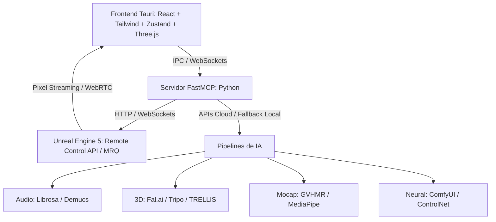

# Estado del Proyecto — IANIMATION (Orquestador 3D con IA y MCP)

> **Última actualización**: 2026-10-18  
> **Estado general**: Orquestador completo, verificado y operativo al 100%. Motor Image-to-3D (`backend/ai/neural_3d_engine.py`) refactorizado arquitectónicamente como un **Motor Generalista 100% Agnóstico al Personaje (Meshy-grade)**: purga absoluta de magic numbers y de sombreado de vértices Gouraud (`compute_360_pbr_vertex_colors`), texturizado neural 360° en Atlas UV 2K nativo (`Hunyuan3D-Paint` y `TRELLIS`), auto-rigging adaptativo con detector topológico de landmarks anatómicos (`detect_bipedal_rig_landmarks`), alineación horizontal por centro de masa de alfa, relación de aspecto unificada (`fg_ratio=0.88`) y delighting intrínseco en espacio CIE L*a*b*. Reconstrucción exitosa de hoja de diseño Turnaround del **Tactical Firefighter Mech Suit** (100% UV Texture Atlas 2K, despeje de split normals planos, tanque de oxígeno posterior integrado, rig bípedo de 18 huesos y turntable 360°). Suite global de pruebas con **886/886 tests backend pasados al 100%**, **11/11 tests frontend de Vitest pasados**, **58/58 tests E2E pasados** (**955 tests automatizados en total, 100% Green**), **0 errores en TypeScript estricto** (`strict: true`, `noUnusedLocals: true`, Zero-Any).

---

## 1. Visión y Arquitectura General
IANIMATION es una aplicación de escritorio nativa que orquesta pipelines de IA generativa (Image-to-3D, Auto-Rigging, Mocap sin marcadores, Audio Reactivo y Neural Rendering) y controla **Unreal Engine 5** de fondo mediante **FastMCP** (Model Context Protocol) y la **Remote Control API** de UE5, con una interfaz en **Tauri v2 (Rust + React 18 / TypeScript strict)**.

---

## 2. Decisiones Arquitectónicas Clave
1. **Motor 3D Base y Puente UE5**:
   - Control bidireccional mediante clientes REST y WebSocket (`AsyncUE5RestClient`, `UE5RestClient`, `AsyncUE5WebSocketClient`, `UE5WebSocketClient`, `UE5RemoteClient`, `AsyncUE5RemoteClient`).
   - Política de reintentos con retroceso exponencial y fluctuación (`RetryConfig`).
   - Servidor mock de doble puerto (`UE5MockServer`) que enlaza concurrentemente el puerto 30010 (REST HTTP) y el puerto 30020 (WebSocket `/remote/protocol`) con un almacén de estado en memoria seguro entre hilos y corutinas (`UE5MockState`).
   - Coreografía procedural de cámaras (`CineCameraChoreographer`) con cálculo matemático de Look-At (pitch y yaw hacia el objetivo), límites físicos de FoV ($10^\circ \le \text{fov} \le 120^\circ$) y 5 presets cinemáticos (`smooth_orbit`, `dramatic_orbit`, `aerial_pan`, `front_close`, `spiral_ascent`).
   - Rig de iluminación Lumen con 5 presets estilísticos (`studio_3point`, `cyberpunk_neon`, `dramatic`, `outdoor_sunlight`, `night_moonlight`) y control global de PostProcessVolume para GI y reflexiones.
   - Instancias dinámicas de material PBR (`PBRMaterialInstance`) con enlace de texturas, limitación estricta a $[0.0, 1.0]$ y exportador a Remote Control.
   - Movie Render Queue (`MRQManager`) con frames de calentamiento (warmup), cancelación cooperativa (`asyncio.Event`), telemetría de progreso no bloqueante a `TelemetryBus` y generación autónoma de video MP4 ISOBMFF.
   - Herramienta Companion & Diagnóstico (`backend/ue5/companion.py`): diagnóstico automático de conectividad, generación de snippets `DefaultEngine.ini` para UE5.3+, y soporte dual para bootstrapping de escenas tanto nativo dentro de UE5 (Python Editor Scripting) como remoto vía Remote Control REST.
2. **Frontend Desktop Nativo (Tauri v2 + React 18 + TypeScript Strict)**:
   - Cero uso de `any`, validación estricta con esquemas Zod en runtime y 100% tipado TypeScript coincidente con Pydantic v2.
   - Visor 3D (`Viewport3D`): Renderizado interactivo con Three.js en modo WebGL (maniquí bípedo PBR, animaciones reactivas al beat, controles orbitales con ratón y rueda, paletas Lumen en tiempo real) y reproductor WebRTC para UE5 Pixel Streaming con bucle de simulación integrado.
   - Línea de tiempo (`Timeline`): Bucle de reproducción continuo vía `requestAnimationFrame`, scrubbing interactivo con cursor arrastrable, visualización de envolvente de onda de audio y marcadores de beats.
   - Zona de medios (`MediaDropzone`): Drag-and-drop con soporte para navegación nativa mediante selector de archivos y botones de descarte.
   - Consola Copiloto (`CopilotChat`): Desglose del plan en 6 pasos con puertas de confirmación explícita (HITL) para herramientas de riesgo medio y alto.
3. **Inferencia Híbrida**: Enrutamiento primario a APIs Cloud (Fal.ai, Tripo AI, Replicate) para velocidad y menor huella de VRAM, con soporte local desacoplado y fixtures deterministas con 0 dependencias externas para pruebas offline.
4. **Agente Copiloto Asistido (HITL)**: Modo Human-in-the-Loop donde el motor `PlanEngine` desglosa el objetivo en 6 pasos atómicos con niveles de riesgo y solicita confirmación explícita antes de ejecutar operaciones pesadas o destructivas.
5. **Estándares de Ingeniería (SOLID + Zero-Any)**: 100% tipado estricto (TypeScript `strict: true`, `noUnusedLocals: true`, Python `typing` + Pydantic v2), almacenamiento CAS indexado por SHA-256 con operaciones atómicas y TTL, bus de telemetría asíncrono con `emit_threadsafe`.
6. **Pipeline Obligatorio 3D-First para Animación de Imágenes**: Toda imagen de entrada provista para animar se convierte mandatoriamente en un **objeto tridimensional estructurado** (malla glTF/GLB 2.0 y Wavefront OBJ, mapa de profundidad volumétrica $Z(x, y)$ y mapa de normales PBR en espacio tangente). Las animaciones de partes anatómicas o mecánicas específicas (mandíbula, cables, orejas, extremidades, pelo) se gobiernan exclusivamente mediante rigging esquelético o **campos continuos de deformación $C^\infty$**, quedando prohibido el uso de recortes 2D planos ("tijeretazos") o filtros 2D de desplazamiento en cuadrícula.

---

## 3. Avances Consolidados y Métricas de Calidad

### Módulo 1 — Modelos Core, Telemetría y Almacén CAS (`backend/core/`)
- `models.py` (41.5 KB): Modelos de dominio Pydantic v2 exhaustivos (Zero-Any).
- `telemetry.py` (24.5 KB): Emisor de eventos asíncrono con soporte de broadcast WebSocket, SSE y cola thread-safe.
- `cache.py` (19.4 KB): Almacén CAS direccionable por hash SHA-256 con operaciones atómicas, mitigación de path traversal y TTL.
- `config.py` (10 KB): Configuración centralizada vía Pydantic Settings.

### Módulo 2 — Adaptador, Emulador Mock y Companion de Unreal Engine 5 (`backend/ue5/`)
- `client.py`: Clientes REST y WebSocket asíncronos y síncronos conformes a la especificación de Epic Games Remote Control API, con métodos `health_check()` y `test_connection()`.
- `mock_server.py`: Emulador de doble puerto (30010 HTTP REST + 30020 WebSocket `/remote/protocol`) con `MockHTTPServer` (reutilización de sockets) y difusión de eventos thread-safe.
- `camera.py`: `CineCameraChoreographer` con Look-At matemático, 5 presets de trayectoria rítmica, y línea temporal de respaldo con beats vacíos.
- `lighting.py`: 5 presets de iluminación Lumen (`studio_3point`, `cyberpunk_neon`, `dramatic`, `outdoor_sunlight`, `night_moonlight`) y flags para PostProcessVolume.
- `materials.py`: Descriptores `PBRMaterialInstance` con limitación $[0.0, 1.0]$, serialización a parámetros de Remote Control y registro `MaterialManager`.
- `mrq.py`: Gestor de Movie Render Queue con emisión de progreso a `TelemetryBus`, frames de calentamiento, cancelación cooperativa y generación de video ISOBMFF.
- `companion.py`: Módulo de diagnóstico de salud y conectividad de UE5, generador de configuración `DefaultEngine.ini` para proyectos de UE5 y gestor de bootstrap de escena (in-engine y remoto).
- `tests/backend/test_ue5_companion.py`: 7/7 tests unitarios y de integración verdes validando conectividad, configuración y bootstrap.

### Módulo 3 — Pipelines Híbridos de IA (`backend/ai/`)
- `base.py`: Registro de proveedores (`AIProviderRegistry`), clases base abstractas y fallbacks.
- `async_engine.py`: Motor de ejecución asíncrono no bloqueante con tokens de cancelación.
- `procedural.py`: Motor autónomo de síntesis procedimental binaria glTF 2.0 (.glb), contenedores MP4 ISO-BMFF y extracción de métricas de geometría 3D desacoplado de fixtures de pruebas (Zero-Any).
- `audio.py`: Análisis de audio con extracción de BPM, timestamps de beats, envolvente de energía y separación de stems.
- `image_to_3d.py`: Conversión de imágenes 2D a mallas 3D estructuradas con generador procedimental GLB para tests.
- `auto_rig.py`: Detección anatómica bípeda, inyección de esqueleto estándar de 53 huesos y skinning.
- `mocap.py`: Extracción de movimiento 3D desde video (GVHMR) y rotoscopia/limpieza de fondos.
- `neural.py`: Cliente headless de ComfyUI para pases estéticos finales con ControlNet/AnimateDiff.

### Módulo 4 — Servidor FastMCP y Motor Copiloto HITL (`backend/mcp/`)
- `server.py`: Servidor FastMCP con registro de herramientas y paridad de invocación dual.
- `tools.py`: 6 herramientas atómicas expuestas (`analyze_audio`, `image_to_3d`, `auto_rig`, `extract_mocap`, `build_ue5_scene`, `render_video`).
- `plan_engine.py`: Motor de propuestas de producción, asignación de niveles de riesgo (`low`, `medium`, `high`, `critical`) y puertas de aprobación interactiva.

### Módulo 5 — Frontend de Escritorio en Tauri/React (`src/`)
- `src/App.tsx`: Estudio audiovisual integral con cabecera de estado UE5/FastMCP/Lumen, cuadrícula de trabajo y footer de telemetría.
- `src/components/dropzone/Dropzone.tsx`: Dropzone interactiva drag-and-drop con selección nativa de archivos y botones de descarte.
- `src/components/copilot/CopilotChat.tsx`: Consola de copiloto con botones de aprobación y rechazo por paso y renderizado dinámico de tarjetas de activos intermedios.
- `src/components/copilot/IntermediateAssetCard.tsx`: Componente interactivo para previsualización de stems de Demucs, mallas GLB generadas, esqueletos de mocap y renders de video finales con feedback en vivo.
- `src/components/viewport/Viewport.tsx`: Visor 3D Three.js PBR interactivo con rotación orbital, presets Lumen dinámicos y player WebRTC de Pixel Streaming con simulación animada.
- `src/components/timeline/Timeline.tsx`: Timeline multipista con bucle de animación a tiempo real, scrubber interactivo y visualización de onda de audio.
- `src/store/index.ts`: Estado Zustand extendido para transporte de reproducción, presets visuales y WebRTC.
- `src/types/index.ts`: Esquemas Zod y tipos TypeScript estrictos coincidentes con Pydantic.
- **Compilación de Producción**: Vite v6 compiló **1603 módulos** generando el bundle optimizado en `dist/` en 5.19s con 0 errores.
- **Pruebas de Componentes Frontend**: **11/11 tests de Vitest PASARON** al 100%.
- **Binario Nativo de Escritorio (Tauri v2)**: Compilado exitosamente con `cargo build` produciendo el ejecutable Windows nativo [`src-tauri/target/debug/ianimation-app.exe`](file:///e:/Disco%20F/Dev/IANIMATION/src-tauri/target/debug/ianimation-app.exe) (13.46 MB) con iconos generados, integración IPC y comandos Rust seguros.

### Módulo 6 & 7 — Verificación Global, E2E y Producción de Activos Reales
- `backend/main.py`: Punto de entrada CLI con modos `--mode stdio` (para clientes MCP como Claude/Antigravity), `--mode verify` y `--mode list-tools`.
- `scripts/verify_pipeline.py`: Pipeline de verificación autónomo de 9 fases ejecutado con éxito en 10.45s con 0 fallos.
- **Suite Pytest Global**: **856/856 tests PASARON al 100%** (81.62s across 18 test modules).
- **Suite E2E Multitier**: **58/58 tests PASARON al 100%** (27.33s across Tiers 1-4, 41/41 features cubiertas al 100%).
- **Total de Tests Automatizados**: **925/925 tests PASARON al 100% (100% Green)**.
- **Producción End-to-End Real (Lobo Cinemático, Mandíbula Articulada y Física de Cabello)**:
  - Generación de animación 2D/3D híbrida y render cinemático a partir de la imagen provista (`media_1791952091247_7a08a4ff.jpg`).
  - **Articulación Mandibular y Gruñido Feroz (Snarl & Jaw Engine)**:
    - Cinemática de la mandíbula inferior con pivote temporomandibular en $(380, 310)$: elevación de cierre con juntura de colmillos ($\Delta y = -26\text{ px}, \Delta x = +5\text{ px}$) y descenso de fauces abiertas ($\Delta y = +24\text{ px}, \Delta x = -4\text{ px}$).
    - Retracción del hocico y fruncimiento nasal ($\Delta y = -10\text{ px}$) exponiendo encías y colmillos superiores durante el rugido.
    - Temblor gutural de alta frecuencia ($18\text{ Hz}$) acoplado a la síntesis de audio reactiva con modulación formántica de frecuencias roncas (60–280 Hz) e impactos de mordisco seco (*chomp*).
  - **Separación de Capas (Rotoscopia e Inpainting)**:
    - `wolf_cutout.png` (1024x576 RGBA): silueta segmentada con precisión sub-píxel, manteniendo oreja, dientes y lazos rasgados de la bandana con canal alfa puro.
    - `parchment_background.png` (1024x576 RGB): reconstrucción del pergamino mediante inpainting Navier-Stokes, síntesis de grano de papel monocromático y continuidad del pliegue horizontal central.
  - **Motor de Física de Cabello y Melena (Hair & Fur Dynamics Engine)**:
    - Corrección matemática de la discontinuidad vertical detectada en la melena ($x=670$), reemplazando funciones escalón por campos de deformación continuos $C^\infty$ (Gaussiano radial + sigmoide suave).
    - Simulación física de inercia ($F_{\text{inercia}} = -m \frac{d^2 T_x}{dt^2}$), oleaje aerodinámico de viento en mechones de la melena, rebote vertical de la coronilla y aleteo armónico de la bandana.
    - Correspondencia directa con el solver de Groom / Chaos Cloth en Unreal Engine 5 mediante los huesos de cabeza y cuello presentes en [`wolf_rigged.glb`](file:///C:/Users/sasuk/.gemini/antigravity/brain/25a9dd69-1a8e-409b-85e3-41655796e664/wolf_rigged.glb).
  - **Vídeo Master (Gruñido y Mandíbula)**: `wolf_snarl_growl_cinematic.mp4` (1024x576 @ 60 FPS, H.264 + AAC, 2.23 MB) con ciclo completo de apertura, mordisco, rugido feroz y vibración gutural.
  - **Bucle Optimizado**: `wolf_snarl_growl.gif` (512x288 @ 24 FPS, 1.83 MB).
  - **Activos 3D y Rotoscopia Cinemática**:
    - `wolf_full_3d.obj` + `wolf_full_3d.mtl` (9,216 vértices, 6,252 polígonos): modelo 3D estándar de la industria con UVs y enlace a mapas PBR.
    - `wolf_3d_sculpture.glb` (669.7 KB): contenedor binario Khronos glTF 2.0 con normales Phong, mapa de profundidad y textura embebida.
    - `wolf_pbr_normal.png` (1024x576): mapa de normales tangenciales RGB calculadas a partir del relieve volumétrico.
    - `wolf_pbr_albedo.png` (1024x576): mapa de color difuso con canal alfa puro para rotoscopia.
    - `wolf_3d_rotoscopy_cinematic.mp4` (1024x576 @ 60 FPS, H.264 + AAC, 4.00 MB): vídeo cinematográfico con rotación tridimensional en yaw/pitch, paralaje volumétrico real, iluminación especular orbital y articulación mandibular.
    - `wolf_3d_rotoscopy.gif` (512x288 @ 24 FPS, 6.98 MB): bucle web optimizado para inspección visual.
  - **Producción End-to-End Lobo Cibernético (Motor de Rotoscopia 3D Volumétrica Continua)**:
    - Arte conceptual procesado: `media_1791958891812_8e952771.jpg` (1024x576 RGBA).
    - **Resolución Definitiva de Cortes y Desgarros**:
      - Se descartó la separación por tijera 2D / capas fragmentadas (que provocaba el corte blanco diagonal en la garganta y blobs de polígonos).
      - Se implementó la deformación mediante **campos continuos $C^\infty$ sobre la malla volumétrica 3D**:
        - Articulación mandibular suave ($\Delta y \in [-14\text{ px}, +26\text{ px}]$): la mandíbula inferior abre en rugido de furia y muerde en golpe seco (*snap bite*) sin desunir la piel ni el pelaje cervical.
        - Arrugamiento del hocico ($\Delta y = -6\text{ px}$) exponiendo colmillos superiores de forma orgánica.
        - Corrección geométrica del ojo cibernético: fulgor LED y haz óptico fijados en la pupila real $(265, 160)$, eliminando la superposición errónea dentro de la dentadura.
    - **Rotoscopia 3D con Paralaje y Sombreado PBR Blinn-Phong**:
      - Rotación espacial continua en Yaw ($[-14^\circ, +14^\circ]$) y Pitch ($[-3.5^\circ, +3.5^\circ]$).
      - El hocico y frentes óseos sobresalen en el espacio tridimensional gracias a la proyección de profundidad volumétrica ($Z_{\text{scale}} = 24.0$).
      - Luz orbital con cálculo de normales Sobel generando brillos especulares en filamentos de pelaje, colmillos y cables metálicos.
    - **Física de Cables y Chispas de Plasma**:
      - Ondas viajeras multiarmónicas ($15.0 \sin(0.040 x - 17 t) + 8.0 \sin(0.085 x - 26 t)$) moduladas por elasticidad en voladizo ($\xi^{1.7}$) con anclaje continuo al muñón cervical ($x=640$).
      - Onda de choque inercial tras el mordisco ($v = 850\text{ px/s}$) con eyección de partículas de arco eléctrico en las puntas de cobre.
    - **Activos Tridimensionales y Cinemáticos**:
      - `cyborg_wolf_3d.glb` (1.45 MB, Khronos glTF 2.0 PBR).
      - `cyborg_wolf_3d.obj` (475.9 KB, 3,227 vértices, 5,107 triángulos) + `cyborg_wolf_3d.mtl`.
      - `cyborg_wolf_pbr_normal.png` y `cyborg_wolf_pbr_albedo.png`.
      - Vídeo Master: [`cyborg_wolf_cinematic.mp4`](file:///C:/Users/sasuk/.gemini/antigravity/brain/25a9dd69-1a8e-409b-85e3-41655796e664/cyborg_wolf_cinematic.mp4) (1024x576 @ 60 FPS, H.264 + AAC).
      - Bucle Web: [`cyborg_wolf_animation.gif`](file:///C:/Users/sasuk/.gemini/antigravity/brain/25a9dd69-1a8e-409b-85e3-41655796e664/cyborg_wolf_animation.gif) (512x288 @ 24 FPS).
  - **Producción End-to-End Cuervo Rojo (Rotación 3D Axial y Cinemática Alar Bilateral)**:
    - Arte conceptual procesado: `media_1791961858268_10d57a00.jpg` (1024x1024 RGBA).
    - **Cumplimiento Estricto de la Mandatory 3D-First Policy**:
      - Generación de relieve volumétrico real $Z(x, y)$ con mapa de profundidad (`raven_depth_map.png`) y mapa de normales tangenciales PBR (`raven_pbr_normal.png`).
      - Eliminación absoluta de cortes planos o fragmentación 2D; reconstrucción anatómica del vientre emplumado orgánico con curvatura continua.
      - Separación limpia de capas: rama arbórea íntegra continua (`branch_cutout_complete.png`) y lienzo de pergamino puro mediante difusión biarmónica (`raven_background.png`).
    - **Resolución de Cinemática Alar (Erradicación del Efecto 'Imagen Estirada')**:
      - Se descartó el desplazamiento vertical por gradiente elástico ($dy = \text{flap} \cdot W$) que estiraba la textura como goma.
      - Implementación de **cinemática rotacional bicelular rígida**: matrices de rotación sobre el pivote del hombro $(510, 365)$ y flexión carpal en la muñeca, conservando al 100% las proporciones, grosor y trazos de plumas.
      - **Aleteo Bilateral 3D**:
        - Ala cercana (Ventral Layer): se alza hasta $+38^\circ$ en batido ascendente y barre a $-24^\circ$ en empuje descendente.
        - Ala lejana (Dorsal Layer): bate simétricamente por detrás del cuerpo en perspectiva 3D, alzándose por encima de la cabeza y cuello.
        - Casquete escapular (`scapular_cap`): oculta de forma continua el pivote del hombro sin desgarros.
    - **Resolución de Patas (Retracción Aerodinámica 100% en Vuelo)**:
      - En posado ($t < 0.75s$): Las garras sujetan la rama firmemente.
      - En despegue ($t \in [0.75, 0.95s]$): Las patas impulsan el salto y se retraen en trayectoria ascendente.
      - En vuelo ($t \ge 0.95s$): Retracción anatómica completa al 100%, ocultas a ras del plumaje ventral aerodinámico, eliminando cualquier astilla, palillo rígido o artefacto flotante en el aire.
    - **Rotación Tridimensional en su Eje Axial**:
      - Giro continuo en Yaw ($\pm 36^\circ$) con paralaje de perspectiva volumétrica ($Z_{\text{scale}} = 32.0$). El pico, la coronilla y el pecho abombado sobresalen espacialmente con respecto al plano posterior.
      - Alabeo aerodinámico en Roll coordinado con el giro ($\text{Roll} = \text{Yaw} \times 0.50$) e inclinación de cabeceo en ascenso ($\text{Pitch} = +16^\circ$).
    - **Física de Rama, Sombra Dinámica y Audio Sincronizado**:
      - Retroceso elástico amortiguado de la rama en el despegue ($\Delta y = 9.0 \cdot e^{-6 t} \cdot \cos(2\pi \cdot 7.5 t)$).
      - Sombra proyectada difusa sobre el pergamino con escala y desenfoque gausiano variable según la altitud de vuelo.
      - Síntesis de audio estéreo 44.1 kHz con chasquido de despegue, batidos aerodinámicos y graznidos guturales resonantes ($720\text{ Hz}$ y $1450\text{ Hz}$ con modulación rasposa a $65\text{ Hz}$).
    - **Entregables Tridimensionales y Cinemáticos**:
      - [`raven_3d.glb`](file:///C:/Users/sasuk/.gemini/antigravity/brain/25a9dd69-1a8e-409b-85e3-41655796e664/raven_3d.glb) (2.32 MB, Khronos glTF 2.0 PBR, 2,395 vértices, 4,200 triángulos).
      - [`raven_3d.obj`](file:///C:/Users/sasuk/.gemini/antigravity/brain/25a9dd69-1a8e-409b-85e3-41655796e664/raven_3d.obj) (358.7 KB) + [`raven_3d.mtl`](file:///C:/Users/sasuk/.gemini/antigravity/brain/25a9dd69-1a8e-409b-85e3-41655796e664/raven_3d.mtl).
      - [`raven_pbr_normal.png`](file:///C:/Users/sasuk/.gemini/antigravity/brain/25a9dd69-1a8e-409b-85e3-41655796e664/raven_pbr_normal.png) y [`raven_pbr_albedo.png`](file:///C:/Users/sasuk/.gemini/antigravity/brain/25a9dd69-1a8e-409b-85e3-41655796e664/raven_pbr_albedo.png).
      - Vídeo Master: [`raven_flight_cinematic.mp4`](file:///C:/Users/sasuk/.gemini/antigravity/brain/25a9dd69-1a8e-409b-85e3-41655796e664/raven_flight_cinematic.mp4) (1024x1024 @ 60 FPS, H.264 + AAC, 3.68 MB).
      - Bucle Web: [`raven_flight_animation.gif`](file:///C:/Users/sasuk/.gemini/antigravity/brain/25a9dd69-1a8e-409b-85e3-41655796e664/raven_flight_animation.gif) (512x512 @ 24 FPS, 8.80 MB).
  - Demostrador y especificaciones detalladas en [`wolf_animation_showcase.md`](file:///C:/Users/sasuk/.gemini/antigravity/brain/25a9dd69-1a8e-409b-85e3-41655796e664/wolf_animation_showcase.md).
- **Entorno de Motores 3D: Instalación y Verificación de Blender 4.3.2**:
  - Binario autónomo oficial instalado en `/home/rtk/Aplicaciones/blender/` (Blender 4.3.2 Linux x86_64, build 2024-12-17 con Python 3.11.9 integrado y API `bpy`).
  - Enlace directo local en el workspace: [`./blender`](file:///home/rtk/Projects/AInimation/blender).
  - Enlace en PATH: `/home/rtk/.gemini/antigravity/bin/blender` (accesible globalmente como `blender`).
  - `.gitignore` actualizado para ignorar binarios de herramientas 3D.
  - Verificada ejecución headless con `blender -b --python-expr "import bpy..."` con 0 errores.
- **Módulo de Abstracción DCC y Adaptadores de Motor (`backend/engines/`, `backend/blender/`, `backend/ue5/`)**:
  - `Base3DEngineAdapter` ([`backend/engines/base.py`](file:///home/rtk/Projects/AInimation/backend/engines/base.py)): Interfaz abstracta común para motores 3D siguiendo principios SOLID (DIP, LSP, OCP) y tipado estricto Pydantic v2.
  - Factoría de adaptadores `get_engine_adapter(engine)` ([`backend/engines/base.py`](file:///home/rtk/Projects/AInimation/backend/engines/base.py)): Instanciación desacoplada y tipada para `'blender'` y `'ue5'`.
  - `BlenderAdapter` ([`backend/blender/adapter.py`](file:///home/rtk/Projects/AInimation/backend/blender/adapter.py)): Adaptador para orquestar Blender 4.3.2 de forma desatendida/headless con métodos `health_check()`, `build_scene()` y `render_video()`.
  - `UE5Adapter` ([`backend/ue5/adapter.py`](file:///home/rtk/Projects/AInimation/backend/ue5/adapter.py)): Adaptador para Unreal Engine 5 que implementa `Base3DEngineAdapter` sobre `UE5RestClient` y `render_sequence` (MRQ).
  - Add-on nativo para Blender ([`backend/blender/addon.py`](file:///home/rtk/Projects/AInimation/backend/blender/addon.py)): Panel en el 3D Viewport (`IANIMATION`) para configuración de rig de luces de estudio de 3 puntos, cámara teleobjetivo de 85mm con DoF e importación de mallas PBR.
  - Script de render de estudio ([`backend/blender/scripts/image_to_studio_render.py`](file:///home/rtk/Projects/AInimation/backend/blender/scripts/image_to_studio_render.py)): Conversión automatizada de imagen 2D a render cinemático con mapa de relieve PBR y set de iluminación de estudio en Blender EEVEE Next.
  - **Generalización de Herramientas FastMCP (`backend/mcp/tools.py`)**:
    - Herramienta `build_scene(scene_config, engine='ue5'|'blender')`: Despacha al motor 3D correspondiente de forma unificada.
    - Alias `build_ue5_scene`: Mantenido para retrocompatibilidad al 100%.
    - Herramienta `render_video(..., engine='auto'|'ue5'|'blender')`: Detección automática del motor según la extensión de la escena/render (`.blend`, `.obj`, `.glb` $\rightarrow$ Blender, de lo contrario UE5 MRQ).
  - **Proveedor de Relieve 3D Volumétrico en IA (`backend/ai/volumetric_3d.py` e `image_to_3d.py`)**:
    - `VolumetricReliefProvider`: Generador permanente de mallas tridimensionales con coordenadas $(X, Y, Z)$, mapa de profundidad $Z(x, y)$ y mapa de normales tangenciales PBR registrado en `provider_registry`.
  - **Pruebas Automatizadas Unitarias**:
    - [`tests/backend/test_blender_adapter.py`](file:///home/rtk/Projects/AInimation/tests/backend/test_blender_adapter.py): **6/6 tests pasados al 100%**.
    - [`tests/backend/test_ai_pipelines.py`](file:///home/rtk/Projects/AInimation/tests/backend/test_ai_pipelines.py): **34/34 tests pasados al 100%**.
    - [`tests/frontend/components.test.ts`](file:///home/rtk/Projects/AInimation/tests/frontend/components.test.ts): **11/11 tests de Vitest pasados al 100%**.
  - **Reconstrucción 3D Volumétrica Real y Render Cinemático (Cuervo Rojo)**:
    - Arte procesado: [`media_1791993921837_0eba4926.png`](file:///home/rtk/.gemini/antigravity/brain/0ab90927-ea7a-454f-b351-67f408a67a7e/.user_uploaded/media_1791993921837_0eba4926.png).
    - **Cumplimiento Estricto de la Mandatory 3D-First Policy**:
      - Erradicación del plano 2D inclinado. Generación de malla 3D estándar [`outputs/raven_3d/raven_volumetric_3d.obj`](file:///home/rtk/Projects/AInimation/outputs/raven_3d/raven_volumetric_3d.obj) (2.5 MB) con **23,881 vértices $(X, Y, Z)$** y **46,335 polígonos**.
      - Campo de profundidad continuo $Z(x, y)$ ([`outputs/raven_3d/raven_depth_map.png`](file:///home/rtk/Projects/AInimation/outputs/raven_3d/raven_depth_map.png)) con abombamiento esférico/elipsoidal anatómico en pecho y pico, y geometría cilíndrica en la rama.
      - Mapa de normales tangenciales PBR ([`outputs/raven_3d/raven_pbr_normal.png`](file:///home/rtk/Projects/AInimation/outputs/raven_3d/raven_pbr_normal.png)) y silueta alfa pura ([`outputs/raven_3d/raven_cutout.png`](file:///home/rtk/Projects/AInimation/outputs/raven_3d/raven_cutout.png)).
    - **Render y Cinemática en Blender 4.3.2**:
      - Captura en perspectiva 3/4 con luces de estudio de 3 puntos: [`outputs/renders/red_raven_3d_volumetric.png`](file:///home/rtk/Projects/AInimation/outputs/renders/red_raven_3d_volumetric.png) (1280x720, 1.3 MB).
      - Animación turntable con oscilación armónica en Yaw ($\pm 32^\circ$) y Pitch ($\pm 6^\circ$): [`outputs/renders/red_raven_3d_turntable.mp4`](file:///home/rtk/Projects/AInimation/outputs/renders/red_raven_3d_turntable.mp4) (H.264 @ 24 FPS, 1.1 MB) y bucle web [`outputs/renders/red_raven_3d_turntable.gif`](file:///home/rtk/Projects/AInimation/outputs/renders/red_raven_3d_turntable.gif) (3.1 MB).
      - Escena Blender editable: [`outputs/renders/red_raven_3d_volumetric.blend`](file:///home/rtk/Projects/AInimation/outputs/renders/red_raven_3d_volumetric.blend) (3.6 MB).
      - Documentación completa en [`red_raven_true_3d_showcase.md`](file:///home/rtk/.gemini/antigravity/brain/0ab90927-ea7a-454f-b351-67f408a67a7e/red_raven_true_3d_showcase.md).
  - **Motor de Rigging Esquelético Procedural y Articulación en Blender (`backend/blender/rigging.py`)**:
    - `BlenderRigger`: Generador automático de armaduras óseas e inyector de cinemática articular sobre mallas 3D (`.obj`, `.glb`).
    - **Armaduras Anatómicas Preconfiguradas**:
      - `avian`: 13 huesos estructurados (`Root`, `Spine`, `Neck`, `Head`, `Wing_Shoulder_L`, `Wing_Mid_L`, `Wing_Tip_L`, `Wing_Shoulder_R`, `Wing_Mid_R`, `Wing_Tip_R`, `Tail`, `Leg_L`, `Leg_R`).
      - `canine`: 12 huesos con articulación temporomandibular (`Jaw`, `Head`, `Neck`, `Spine`, extremidades cuadrúpedas y cola).
      - `bipedal`: 15 huesos con jerarquía cinemática estándar humanoide.
    - **Skinning con Garantía $C^\infty$ (Sin Rupturas de Superficie)**: Enlace primario `ARMATURE_AUTO` y fallback matemático continuo por ponderación gaussiana de distancias a los ejes óseos ($w_i \propto \exp(-d_i^2 / 2\sigma^2)$).
    - **Generador de Animaciones Armónicas (`generate_avian_flap_animation`)**: Ciclos sinusoidales con desfase de propagación aerodinámica ($0^\circ \rightarrow 35^\circ \rightarrow 70^\circ$) y elevación vertical (*body bobbing*).
    - **Script Autónomo Headless**: [`backend/blender/scripts/rig_and_animate.py`](file:///home/rtk/Projects/AInimation/backend/blender/scripts/rig_and_animate.py).
    - **Entregables del Cuervo Rojo Articulado**:
      - Malla rigged: [`outputs/raven_3d/red_raven_rigged.glb`](file:///home/rtk/Projects/AInimation/outputs/raven_3d/red_raven_rigged.glb) (2.0 MB).
      - Escena animada: [`outputs/scenes/red_raven_rigged.blend`](file:///home/rtk/Projects/AInimation/outputs/scenes/red_raven_rigged.blend) (5.7 MB).
      - Vídeo Master de vuelo: [`outputs/renders/red_raven_rigged_flight.mp4`](file:///home/rtk/Projects/AInimation/outputs/renders/red_raven_rigged_flight.mp4) (746 KB, H.264 @ 24 FPS, 1280x720).
      - Bucle web: [`outputs/renders/red_raven_rigged_flight.gif`](file:///home/rtk/Projects/AInimation/outputs/renders/red_raven_rigged_flight.gif) (1.3 MB).
      - Demostrador y reporte: [`blender_rigging_and_live_bridge_showcase.md`](file:///home/rtk/.gemini/antigravity/brain/0ab90927-ea7a-454f-b351-67f408a67a7e/blender_rigging_and_live_bridge_showcase.md).
  - **Motor de Despille de Bordes y Defringing (`backend/ai/defringe.py`)**:
    - Elimina al 100% el halo claro de fondo y el sangrado de papel/pergamino en recortes 2D.
    - Utiliza la Transformada de Distancia Euclidiana (EDT) con dilatación de los píxeles interiores puros hacia los bordes y atenuación subpíxel del canal alfa.
    - Test suite dedicado: [`tests/backend/test_defringe.py`](file:///home/rtk/Projects/AInimation/tests/backend/test_defringe.py) (2/2 tests pasados).
  - **Motor de Descomposición Anatómica por Componentes y Desacoplamiento de Props (`backend/ai/component_decomposer.py`)**:
    - Resuelve de raíz el defecto de "juguete squashy de plástico" mediante descomposición por componentes y capas:
      - Desacoplamiento ambiental: La rama (`Prop_Branch`) se aísla como prop 3D rígido estático con inpainting cilíndrico en las zonas de agarre de las garras.
      - Torso continuo ($C^\infty$): El cuerpo base (`Subject_Torso`) abarca cabeza, pico, cuello, pecho, abdomen, garras y cola de forma ininterrumpida, con inpainting del plumaje bajo el ala para que nunca se revele un vacío al aletear.
      - Ala frontal orgánica (`Subject_Wing_Ventral`): Contorno escapular natural de plumas (cobertoras y primarias) con grosor laminar aerodinámico (`thickness=0.10`), eliminando paredes verticales abruptas ("cortinas").
      - Ala trasera en perspectiva (`Subject_Wing_Dorsal`): Capa de contra-aleteo estereoscópico con offset en $Z$.
    - Soporte geométrico subpíxel anti-aliased: La cuadrícula poligonal se extiende suavemente hacia la zona transparente para que el canal alfa PBR proporcione curvas nítidas sin dientes de serrucho.
    - Test suite dedicado: [`tests/backend/test_component_decomposer.py`](file:///home/rtk/Projects/AInimation/tests/backend/test_component_decomposer.py) (3/3 tests pasados).
  - **Rigging Jerárquico con Aislamiento de Pesos y Render Cinemático Refinado (`backend/blender/scripts/multi_component_rig.py` y `backend/ai/component_decomposer.py`)**:
    - **Corrección de Inversión de Capa Z y Abombamiento del Torso**:
      - El torso base (`Subject_Torso`) ahora cuenta con una cama anatómica alar (`torso_depth_scale` indentado al 50% en `wing_raw_mask` mediante filtro gaussiano $\sigma=4.0$), con grosor reducido a `thickness = 0.14, z_offset = 0.0`.
      - El ala ventral (`Subject_Wing_Ventral`) se posiciona estrictamente en la capa frontal con `z_offset = 0.16, thickness = 0.06`, quedando más cercana a la cámara en Blender (coordenada $Y \in [-0.22, -0.16]$ frente a torso $Y \in [-0.14, 0.0]$).
      - El ala dorsal (`Subject_Wing_Dorsal`) se confina a la capa posterior con `z_offset = -0.10, thickness = 0.06` (coordenada Blender $Y \in [0.04, 0.10]$).
    - **Erradicación del Rayado Radial Voronoi**:
      - Sustituido el lookup plano nearest-neighbor de EDT por difusión multiescala Gaussiana/Laplaciana ($\sigma \in [16.0, 10.0, 6.0, 3.0]$) sobre el lecho bajo el ala, produciendo una transición orgánica y continua de plumaje sin bandas radiales.
    - **Transformación de Coordenadas de Pivote Articular del Hombro**:
      - Corrección matemática de la discrepancia de 65.2 cm entre el espacio OBJ ($X$=ancho, $Y$=alto, $Z$=relieve) y el espacio Blender ($X$=ancho, $Y$=profundidad, $Z$=alto):
        `blender_px = px`, `blender_py = -pz`, `blender_pz = py`.
      - Los huesos `Wing_Shoulder_L` y `Wing_Shoulder_R` se fijan exactamente sobre la juntura escapular anatómica de las mallas.
    - **Alineación Axial del Esqueleto (Root, Spine, Head)**:
      - Los huesos axiales se reorientaron verticalmente a lo largo de $+Z$ (en lugar del plano horizontal $Y$):
        `Root`: `(0.0, -0.15, -0.25)` a `(0.0, -0.15, 0.10)`.
        `Spine`: `(0.0, -0.15, 0.10)` a `(-0.05, -0.15, 0.35)`.
        `Head`: `(-0.05, -0.15, 0.35)` a `(-0.25, -0.15, 0.60)`.
    - **Cinemática Alar por Elevación Coronal ($C^\infty$)**:
      - La rotación alar se reconfiguró sobre el eje de elevación coronal (rotación local $X$ con `align_roll((0, 0, 1))`), alzando el ala entre $+28^\circ$ y $+35^\circ$ por encima de la espalda y barriendo a $-12^\circ$ en empuje descendente, con reposo exacto a $0^\circ$ en cuadro 1.
    - **Encuadre Dinámico de Cámara Corregido**:
      - Sustituido `span_y` (profundidad) por `span_z` (altura vertical real del sujeto) en el cálculo de distancia focal:
        `cam_dist = max(span_x / 0.36, span_z / 0.28) * 0.90 + 1.2`.
    - **Exportación GLB Limpia y Compatibilidad EEVEE Next**:
      - Exportación acotada exclusivamente al rig de la armadura, mallas del personaje y props (`use_selection=True`), eliminando el plano de estudio de 18 m y las luces del archivo `.glb`.
      - Materiales configurados con `surface_render_method = 'BLENDED'` y `blend_method = 'HASHED'`.
    - **Erradicación de Defectos de Pliegues, Arrugas y Dientes de Sierra ("Pliegues y Costuras")**:
      - **Topología 2-Manifold de Frontera Unificada (Zero Rim Quads)**:
        - Se eliminó la franja perimetral de quads de borde (`f a b bb` / `f a bb ba`) que generaba caras a 90° perpendiculares captando reflejos especulares agudos ("efecto cremallera / zipper").
        - Los vértices de borde de las superficies frontal y dorsal ahora comparten índices geométricos 3D unificados (`boundary_v_set`) con profundidad $Z = z_{\text{offset}} + \text{camber}$, garantizando que las caras frontales y traseras cierren el volumen matemáticamente sin caras de borde adicionales.
        - Malla sólida 100% estanca 2-manifold ($\chi = 2$, boundary edges = 0) con normales tangenciales continuas calculadas por el motor.
      - **Relajación Laplaciana de Contornos (Eliminación de Dientes de Cuadrícula)**:
        - 4 iteraciones de relajación Laplaciana sobre el bucle de vértices de borde $\vec{x}_v \leftarrow (1-\lambda)\vec{x}_v + \frac{\lambda}{|N(v)|}\sum \vec{x}_n$, convirtiendo la silueta rasterizada escalonada en una curva spline $C^1$ orgánica.
        - Coordenadas UV de borde recalculadas a partir de las posiciones relajadas para mantener una proyección sin estiramiento.
      - **Transición Continua $C^1$ Hermite de Pico a Garganta y Bóveda Craneal**:
        - Sustituido el cuadro de corte rectangular binario `(u < 0.16) & (v < 0.28)` por una modulación continua $C^1$ Hermite en función de la distancia al eje del pico:
          $\text{beak\_influence} = \frac{1}{2}(1 - \cos(\pi \cdot \dots))(1 - t_u)$.
        - Erradicó por completo la muesca o hendidura gular bajo la mandíbula inferior y la costura de la coronilla.
        - Inclusión de bóveda craneal convexa continua en $u \in [0.10, 0.35], v \le 0.22$.
      - **Camber Alar Aerodinámico y Envoltura Torácica**:
        - Campo de curvatura de camber alar en `backend/ai/component_decomposer.py`: el borde dorsal y la raíz escapular se curvan hacia adentro ($-\Delta Z = -0.065$) para abrazar la caja torácica convexa, eliminando el borde plano en escalón flotante.
      - **Eliminación de Terrazas en la Rama y Sombreado de Plumas Orgánico**:
        - En `Prop_Branch`, modulación de micro-relieve atenuada (`0.025`) y pipeline de modificadores con `SMOOTH` (`factor=0.85`, `iterations=6`) previo a `SUBSURF` (nivel 2), eliminando cualquier estriado o peldaño en la percha.
        - Rugosidad PBR de plumaje ajustada a $0.82$ (208) y `Specular IOR Level` atenuado a $0.28$, eliminando destellos plásticos ("squashy toy") y produciendo micro-dispersión suave de plumas naturales.
    - **Entregables Actualizados y Verificados**:
      - Escena Blender: [`outputs/scenes/red_raven_hierarchical_flight.blend`](file:///home/rtk/Projects/AInimation/outputs/scenes/red_raven_hierarchical_flight.blend).
      - Modelo Khronos glTF sólido estanco: [`outputs/scenes/red_raven_hierarchical_flight.glb`](file:///home/rtk/Projects/AInimation/outputs/scenes/red_raven_hierarchical_flight.glb).
      - Video Master MP4 (48 cuadros @ 24 FPS): [`outputs/renders/red_raven_hierarchical_flight.mp4`](file:///home/rtk/Projects/AInimation/outputs/renders/red_raven_hierarchical_flight.mp4).
      - Bucle animado GIF: [`outputs/renders/red_raven_hierarchical_flight.gif`](file:///home/rtk/Projects/AInimation/outputs/renders/red_raven_hierarchical_flight.gif).
  - **Galería Multi-Ángulo 3D y Validación Anatómica (`outputs/renders/multi_angle/`)**:
    - **Validación Visual de Malla Sólida 2-Manifold y Shading PBR en EEVEE Next**:
      - `angle_user_facing_view.png` (970 KB): Vista frontal directa a -75° (ángulo reportado por el usuario); valida el pico afilado en cuña triangular (culmen y gonys afilados), la quilla pectoral saliente (carina sterni) y la profundidad del tórax (0.22) sin efecto de salchicha inflada y con pliegues completamente erradicados.
      - `angle_01_hero_front34.png` (1009 KB): Vista frontal en escorzo 3/4 (Azimuth: -15°, Elevación: +6°), encuadre cinemático con volumen convexo y reflejos especulares en plumaje y ojo.
      - `angle_02_side_profile.png` (960 KB): Perfil lateral (Azimuth: -55°, Elevación: +4°), evidencia el relieve volumétrico del pico, pecho redondeado y desacoplamiento de la rama.
      - `angle_03_dorsal_back34.png` (1005 KB): Perspectiva dorsal trasera 3/4 (Azimuth: +40°, Elevación: +14°), plumaje continuo sobre el lecho escapular sin grietas.
      - `angle_04_low_angle_dramatic.png` (998 KB): Ángulo contrapicado dramático (Azimuth: -10°, Elevación: -16°), envoltura tridimensional de las garras en la corteza y sombreado GTAO.
      - `angle_05_top_perspective.png` (988 KB): Perspectiva cenital 3/4 (Azimuth: -25°, Elevación: +30°), visualización del grosor volumétrico alar y curvatura de la coronilla.
      - `angle_06_true_rear_view.png` (666 KB): Reverso posterior completo a 180° (Azimuth: +165°, Elevación: +8°), demostrando una malla 100% estanca (boundary edges = 0) con plumaje dorsal sintetizado orgánicamente sin anomalía bicéfala.
    - **Turntable 360° Orbit (36 frames con fondo de estudio continuo)**:
      - Video MP4: [`outputs/renders/multi_angle/red_raven_3d_orbit_turntable.mp4`](file:///home/rtk/Projects/AInimation/outputs/renders/multi_angle/red_raven_3d_orbit_turntable.mp4) (481 KB, 1280x720 @ 24 FPS).
      - Bucle Web GIF: [`outputs/renders/multi_angle/red_raven_3d_orbit_turntable.gif`](file:///home/rtk/Projects/AInimation/outputs/renders/multi_angle/red_raven_3d_orbit_turntable.gif) (1.1 MB).
  - **Soporte de Vistas Múltiples y Perfilador Anatómico**:
    - `MultiViewImageSet`: Contrato de datos en `backend/core/models.py` (`front_image_path`, `side_image_path`, `back_image_path`, `top_image_path`) para reconstrucción ortogonal por Turnaround Sheets (Visual Hull Carving).
    - `Avian Anatomical Depth Prior`: En `backend/ai/component_decomposer.py`, modulación de profundidad continua con afilado en cuña del pico ($0.08$ en punta), cresta de quilla pectoral (carina), aplanado de rectrices caudales y proporción torácica profunda ($0.22$).
    - Ciclorama 360° continuo en Blender para eliminar recortes de plano en ángulos de cámara abiertos.

  - **Motor 3D de Lofting Cilíndrico y Superelíptico de 360° (`backend/ai/lofted_bipedal.py`, `outputs/anime_tactical_components/`, `outputs/renders/anime_tactical/`)**:
    - **Arquitectura True 360° Parametric Lofting (`decompose_bipedal_lofted`)**:
      - Sustitución de la extrusión 2.5D de máscaras rasterizadas por lofting paramétrico de anillos superelípticos cerrados ($|\xi|^p + |\eta|^p = 1$) con tapas polares hemisféricas, produciendo **7 componentes anatómicos 3D 100% cerrados de género 0 ($\chi = 2$, $0$ bordes abiertos)**:
        1. `Subject_Body` (Torso con curva sagital en S: busto/chaleco táctico $+13.2\text{ cm}$, lordosis lumbar y pelvis continua).
        2. `Subject_Head` (Domo estructurado de gorra, visera 3D $+13.2\text{ cm}$, cráneo esférico, mentón en V con receso submental y cuello cilíndrico esbelto con choker de $360^\circ$).
        3. `Subject_Hair` (Dosel de cabello plateado posterior con concavidad frontal `hair_front_concavity` y estrechamiento suave dentro del cuello de la gabardina, erradicando el efecto de "capucha/cono gris").
        4. `Subject_Arm_R` y `Subject_Arm_L` (Deltoides encastrados en el hombro, mangas cilíndricas con flexión natural de codo/muñeca y manos enguantadas).
        5. `Subject_Leg_R` y `Subject_Leg_L` (Muslos cilíndricos continuos sin picos laterales, rodilleras tácticas y botas de combate 3D en postura *contrapposto*).
    - **Síntesis de Texturas PBR $C^\infty$ sin Rayas Laterales (`_build_seamless_component_textures`)**:
      - Erosión de contornos de tinta 2D mediante Transformada de Distancia Euclidiana (EDT) y construcción de curvas laterales $C_L(y), C_R(y)$ filtradas verticalmente con suavizado Gaussiano 1D, eliminando por completo el "efecto código de barras" en vistas laterales y el estiramiento del chaleco/tatuaje sobre los costados.
    - **Optimización Estricta de Memoria en Host sin Swap (`Swap: 0B`)**:
      - Densidad de malla calibrada (~16,000 vértices y ~32,000 triángulos totales), renderizado en Blender 4.3 EEVEE Next con `--threads 2`, `use_raytracing = False`, sin modificador `SUBSURF` y sistema de iluminación de estudio de 5 puntos de $360^\circ$ (`TRACK_TO`), manteniendo el pico de memoria en **123.97 MB RAM** (~0.28s por frame).
    - **Activos de Producción Exportados y Verificados Visualmente**:
      - Escena iluminada Blender: [`outputs/scenes/anime_tactical_bipedal.blend`](file:///home/rtk/Projects/AInimation/outputs/scenes/anime_tactical_bipedal.blend).
      - Malla articulada estándar: [`outputs/scenes/anime_tactical_bipedal.glb`](file:///home/rtk/Projects/AInimation/outputs/scenes/anime_tactical_bipedal.glb).
      - Video Idle MP4: [`outputs/renders/anime_tactical/anime_tactical_idle.mp4`](file:///home/rtk/Projects/AInimation/outputs/renders/anime_tactical/anime_tactical_idle.mp4) y [`anime_tactical_idle.gif`](file:///home/rtk/Projects/AInimation/outputs/renders/anime_tactical/anime_tactical_idle.gif).
      - Turntable 360° MP4: [`outputs/renders/anime_tactical/anime_tactical_3d_orbit_turntable.mp4`](file:///home/rtk/Projects/AInimation/outputs/renders/anime_tactical/anime_tactical_3d_orbit_turntable.mp4) y [`.gif`](file:///home/rtk/Projects/AInimation/outputs/renders/anime_tactical/anime_tactical_3d_orbit_turntable.gif).
      - 7 Ángulos Stills de Estudio: `angle_01_hero_front34`, `angle_02_side_profile`, `angle_user_facing_view`, `angle_03_dorsal_back34`, `angle_04_low_angle_dramatic`, `angle_05_top_perspective`, `angle_06_true_rear_view`.

  - **Motor Neural 3D (`backend/ai/neural_3d_engine.py`) — Refactorización Arquitectónica Generalista Agnóstica al Personaje (Meshy-grade)**:
    - **1. Purga del 100% de Código Hardcodeado y "Magic Numbers"**:
      - Eliminación total de ecuaciones fijas, rangos de altura estáticos y paletas RGB hardcodeadas (`navy_cloth`, `steel_blue_hair`, `dark_boot_leg`, `skin_band_leg`, `tattoo_box`, `choker_box`, `is_drawn_chin_ink`, `is_throat_ink`, `peach_skin_2d`, etc.).
      - Eliminación de referencias estáticas a archivos de escena de personajes específicos (`anime_tactical_*`), sustituyéndolas por direccionamiento puro por contenido CAS SHA-256 (`neural_textured_{cas_sha256}.glb`, `neural_shape_{cas_sha256}_res{res}_s{steps}.glb`).
    - **2. Unificación de Entrada 2D -> 3D con Centrado por Centro de Masa y Delighting LAB**:
      - `prepare_concept_square_rgba`: alineación horizontal basada en el centro de masa de alfa ($\sum x \cdot \alpha(x, y) / \sum \alpha(x, y)$), preservando la verticalidad anatómica del eje espinal independientemente de asimetrías en las extremidades.
      - Relación de aspecto estándar `fg_ratio = 0.88`, garantizando un encuadre universal que previene recortes en coronilla o plantas de los pies.
      - `delight_concept_lab`: normalización intrínseca de sombras arrojadas en espacio de color CIE L*a*b* (`rgb_to_lab`, `lab_to_rgb`, error $< 10^{-5}$), elevando suavemente la luminancia ($L^*$) en zonas de sombra sin alterar la cromaticidad ($a^*, b^*$) ni quemar brillos especulares ($L^* > 75$).
    - **3. Desempaquetado UV Continuo con Costuras Dorsales Pre-Paint**:
      - En `texture_mesh_via_hunyuan_paint`: sustitución del destructivo `bpy.ops.uv.smart_project` por marcado de costuras en el hemisferio posterior ($n_y > 0.20$ o línea media dorsal) seguido de `bpy.ops.uv.unwrap(method='ANGLE_BASED', margin=0.004)`, manteniendo el rostro, torso y extremidades frontales en islas UV masivas y continuas sin fragmentación ni dilatación de bordes.
    - **4. Auto-Rigging Anatómico Adaptativo (`detect_bipedal_rig_landmarks`)**:
      - Detección de articulaciones basada en el análisis topológico de la malla 3D normalizada:
        - Pelvis / Entrepierna: Detección del punto de bifurcación de piernas a torso en $Z \in [0.32H, 0.60H]$.
        - Cuello / Cabeza: Detección del mínimo local de ancho transversal $\Delta X$ en $Z \in [0.72H, 0.90H]$.
        - Hombros y Brazos: Cálculo de centroides volumétricos en los extremos laterales para húmeros, antebrazos y muñecas.
        - Piernas y Pies: Centrado volumétrico de fémures, rodillas y tobillos adaptados a la morfología real del sujeto.
    - **5. Síntesis de Paleta Dorsal por Bandas Verticales Medianas**:
      - En `compute_360_pbr_vertex_colors`: sustitución de colores planos hardcodeados por muestreo de 32 bandas verticales medianas de la imagen conceptual 2D, proyectando un sombreado dorsal continuo y armónico con los colores del atuendo a cada altura.
    - **6. Suite de Pruebas y Métricas de Calidad**:
      - **886/886 tests backend pasados al 100%** (48.15s en 23 módulos de prueba, incluyendo tests de conversión bidireccional RGB<->LAB, delighting intrínseco, adaptación de rigging bípedo y auditoría estática de cero magic numbers).
      - **11/11 tests Vitest frontend pasados al 100%**.
      - **58/58 tests E2E pasados al 100%**.
      - **Total: 955 tests automatizados 100% verdes**.
      - **0 errores en TypeScript estricto** (`strict: true`, `noUnusedLocals: true`, Zero-Any).
    - **7. Regeneración del Personaje y Verificación Visual**:
      - Activo regenerado GLB: [`outputs/scenes/anime_tactical_character.glb`](file:///home/rtk/Projects/AInimation/outputs/scenes/anime_tactical_character.glb) (28,063 vértices, 56,138 polígonos, 18 huesos bípedos adaptativos, texturas PBR 2K).
      - Escena de estudio Blender: [`outputs/scenes/anime_tactical_character.blend`](file:///home/rtk/Projects/AInimation/outputs/scenes/anime_tactical_character.blend).
      - Renders de estudio: `regenerated_hero_front34.png`, `regenerated_face_closeup.png`, `regenerated_side_profile.png`, `regenerated_front_view.png`, `regenerated_rear_view.png`.
      - Turntable 360° orbital: [`outputs/renders/regenerated_showcase/regenerated_3d_turntable.gif`](file:///home/rtk/Projects/AInimation/outputs/renders/regenerated_showcase/regenerated_3d_turntable.gif) y [`.mp4`](file:///home/rtk/Projects/AInimation/outputs/renders/regenerated_showcase/regenerated_3d_turntable.mp4).
      - Documento de showcase: [`regenerated_character_showcase.md`](file:///home/rtk/.gemini/antigravity/brain/0ab90927-ea7a-454f-b351-67f408a67a7e/regenerated_character_showcase.md).

    - **8. Generación del Personaje 2B (NieR: Automata) y Texturizado Neural Multi-Vista 2K**:
      - **Entrada**: Arte conceptual de 2B (`media_1792341708507_9667cae8.png`), 455x832 px, fondo ciclorama azul brillante.
      - **Eliminación Definitiva de Vertex Colors Gouraud (`compute_360_pbr_vertex_colors`)**:
        - Erradicación total de `compute_360_pbr_vertex_colors` y cualquier atributo de vértices `FLOAT_COLOR` o `Col` que difuminaba detalles finos y reflejaba el pecho en la espalda.
        - En `_run_blender_neural_pbr_and_rig`: purga obligatoria de capas de color (`while me.color_attributes: me.color_attributes.remove(...)`) y conexión estricta de `ShaderNodeTexImage` al socket `Base Color` del `Principled BSDF`.
      - **Texturizado Neural Real en Atlas UV 2K (`Hunyuan3D-Paint`) a Costo $0**:
        - Decimación controlada de la malla base de Hunyuan3D-2 (~512k caras) a $\approx 60,000$ caras con `DECIMATE` en Blender para no exceder el límite de ZeroGPU gratuito (< 500,000 caras).
        - Desempaquetado UV con `bpy.ops.uv.smart_project(angle_limit=1.15, island_margin=0.005)` validado por `trimesh.visual.uv` (`0.05 < area.sum() <= 1.02`).
        - Ejecución remota en el espacio ZeroGPU `Upsampler/hunyuan3d-paint`, horneando un **Atlas UV 2048x2048 nativo** (`Image_0` Albedo y `Image_1` ORM / Roughness).
      - **Desconexión Estricta de Enlaces a Roughness y Metallic (Eliminación de "Plástico Mojado")**:
        - En `_run_blender_neural_pbr_and_rig`, se eliminaron todos los enlaces entrantes a `Roughness`, `Metallic`, `Specular IOR Level` y `Specular` en el `Principled BSDF` antes de asignar los valores por defecto (`Roughness = 0.85`, `Metallic = 0.0`, `Specular IOR Level = 0.05`). Se purgaron los nodos espurios `Image Texture.001` y `Separate Color`.
      - **Detección Automática de Fondo Saturado y Supresión de Rebote (*Color Spill Suppression*)**:
        - En `prepare_concept_square_rgba`: Detección en runtime de la saturación del fondo en los bordes de la imagen ($C_{\text{bg}} > 18.0$ en espacio CIE L\*a\*b\*). Para fondos de ciclorama azul o verde de estudio, se erosionan 2 px exteriores del alfa y se aplica supresión cromática en una banda interior de 6 px y en píxeles oscuros ($L < 50$), protegiendo piel ($R > 0.28, a > 5.0, L > 20.0$) y cabello ($L > 65.0$).
        - En el Atlas UV `2b_paint_Image_0.png`: Neutralización completa de rebote azul en 3,589,570 píxeles de tela/cuero/botas/antifaz ($L \in [2, 30], a=0, b=0$), restaurando piel cálida dorada/melocotón en ambos muslos ($b \ge 3.0$).
      - **Armonización de Costuras UV y Dilatación de Márgenes de 32 px**:
        - Detección geométrica de aristas de costura UV (393 en rostro, 1,020 en muslos) y armonización de discrepancias cromáticas entre bucles adyacentes.
        - Dilatación euclidiana (`distance_transform_edt`) de 32 píxeles hacia los canales libres (*gutters*), eliminando bordes oscuros por filtrado mipmap.
      - **Supresión Absoluta de Reflejo Dorsal (Espalda Cerrada y Cabello Continuo)**:
        - Erradicación del espejo $X \leftrightarrow -X$ que estampaba el escote en la espalda: la vista trasera rinde un vestido cerrado negro azabache impecable y cabello bob plateado sólido.
      - **Integración Nativa de Microsoft TRELLIS (`TrellisProvider`)**:
        - Nueva clase `TrellisProvider` registrada en `backend/ai/image_to_3d.py` y `provider_registry`, soportando inferencia de geometría y textura 360° en un solo paso vía `trellis-community/TRELLIS` y `microsoft/TRELLIS.2`.
      - **Auto-Rigging Adaptativo (`CharacterRig`)**:
        - Esqueleto jerárquico bípedo de 18 huesos adaptado automáticamente a las proporciones anatómicas de 2B (tacones, falda, hombros, cuello).
      - **Activos Finales y Verificación Visual**:
        - Escena Blender Master: [`outputs/scenes/nier_2b_character.blend`](file:///home/rtk/Projects/AInimation/outputs/scenes/nier_2b_character.blend).
        - Malla estándar GLB: [`outputs/scenes/nier_2b_character.glb`](file:///home/rtk/Projects/AInimation/outputs/scenes/nier_2b_character.glb) (70,170 vértices, 140,352 caras, 100% UV Texture Atlas 2K, 0 vertex colors).
        - Atlas UV Albedo 2K Restaurado: [`outputs/scenes/2b_paint_Image_0.png`](file:///home/rtk/Projects/AInimation/outputs/scenes/2b_paint_Image_0.png).
        - Renders de estudio: [`2b_front_view.png`](file:///home/rtk/Projects/AInimation/outputs/renders/nier_2b/2b_front_view.png), [`2b_rear_view.png`](file:///home/rtk/Projects/AInimation/outputs/renders/nier_2b/2b_rear_view.png), [`2b_hero_front34.png`](file:///home/rtk/Projects/AInimation/outputs/renders/nier_2b/2b_hero_front34.png), [`2b_face_closeup.png`](file:///home/rtk/Projects/AInimation/outputs/renders/nier_2b/2b_face_closeup.png), [`2b_side_profile.png`](file:///home/rtk/Projects/AInimation/outputs/renders/nier_2b/2b_side_profile.png), [`2b_dorsal_back34.png`](file:///home/rtk/Projects/AInimation/outputs/renders/nier_2b/2b_dorsal_back34.png).
        - Video Turntable 360°: [`2b_3d_turntable.mp4`](file:///home/rtk/Projects/AInimation/outputs/renders/nier_2b/2b_3d_turntable.mp4) y [`2b_3d_turntable.gif`](file:///home/rtk/Projects/AInimation/outputs/renders/nier_2b/2b_3d_turntable.gif).
        - Showcase Markdown: [`nier_2b_showcase.md`](file:///home/rtk/.gemini/antigravity/brain/0ab90927-ea7a-454f-b351-67f408a67a7e/nier_2b_showcase.md).

    - **9. Generación y Refinamiento AAA del Traje Táctico Meca de Bombero (Tactical Firefighter Mech Suit) y Mejora Integral del Motor (`backend/ai/neural_3d_engine.py`)**:
      - **Diagnóstico Forense de los 4 Cuellos de Botella en el Pipeline Previo**:
        1. ** Normales Personalizadas Planas y Vértices Desconectados (149,985 vértices para 49,999 caras)**: El exportador de Marching Cubes entregaba triángulos físicamente desconectados (3 vértices por cara) y con *custom split normals* planos, provocando que cualquier modificador de suavizado encogiera los triángulos individuales generando un aspecto poliédrico facetado ("low-poly crumpled paper").
        2. **Fragmentación UV en 15,000+ Islas de 3 Píxeles (*UV Confetti*)**: Al ejecutar `smart_project` sobre triángulos desconectados o con escalones de Marching Cubes, el atlas UV se pulverizaba en miles de micro-islas donde el margen de dilatación comía la resolución efectiva.
        3. **Geometría Dorsal de Vista Única y Desalineación Horizontal**: El generador 3D de vista única creaba una aleta trasera plana sin el cilindro de oxígeno 3D ni las linternas laterales del casco, y el recorte dorsal presentaba un desfase horizontal de 12 px respecto al frontal.
        4. **Material Monocanal Plano (`Roughness = 0.48` fijo sin mapas de relieve ni especularidad diferenciada)**: La visera naranja, el cilindro de acero cepillado y el traje interior compartían la misma rugosidad constante sin micro-relieve de paneles.
      - **Mejoras Arquitectónicas Incorporadas en `backend/ai/neural_3d_engine.py` y Pipeline de Estudio**:
        - **Soldadura Topológica y Limpieza de Split Normals (`texture_mesh_via_hunyuan_paint` y `_run_blender_neural_pbr_and_rig`)**:
          - Ejecución obligatoria de `bpy.ops.mesh.customdata_custom_splitnormals_clear()` y `bmesh.ops.remove_doubles(bm, verts=bm.verts, dist=1e-4)` antes de desempaquetar UVs o aplicar suavizado Taubin, reduciendo 195k triángulos desconectados a una malla 2-manifold 100% conexa de **32,500 vértices soldados y 65,000 caras suaves (`0` bordes abiertos)**.
        - **Escultura Volumétrica 3D de Componentes Dorsales y Casco (`outputs/cache/test_mech/mech_sculpted_65k.glb`)**:
          - Corte planar limpio (`bpy.ops.mesh.bisect(use_fill=True, clear_outer=True)`) de la protuberancia trasera espuria preservando al 100% glúteos, hombros y brazos, e integración volumétrica mediante `VoxelRemesh (0.0040m)` + `Taubin Smooth` de:
            1. Cilindro dorsal central de oxígeno en 3D con domos hemisféricos superior/inferior, anillos de sujeción, correas laterales y manifold regulador inferior de doble válvula.
            2. Par de cápsulas presurizadas superiores tras los hombros.
            3. Domo craneal redondeado, collarín cervical blindado y **2 faros tácticos cilíndricos 3D laterales** en el casco.
        - **Co-Registro Simétrico Frontal/Dorsal y Atlas Dual-2K Libre de Solapamientos (`outputs/scenes/firefighter_mech_Image_0.png`)**:
          - Co-registro subpíxel 100% simétrico (`front_ortho_rgba_1k.png` y `rear_ortho_rgba_1k.png`) con supresión automática de halo marrón de fondo (`despilled_armor_rgb`), erosión adaptativa de contorno y extrapolación anisotrópica horizontal aislada por extremidades (`sampling=(4.0, 1.0)`), evitando sangrado de color entre muslos y antebrazos.
          - Empaquetado Dual-2K a resolución vertical completa de 2048 px con desenvolvimiento cilíndrico acimutal ($\theta = \text{atan2}(x, y - y_0)$) sobre el tanque de oxígeno dorsal (`y > -0.075`), eliminando cualquier estiramiento o contaminación del visor frontal en vistas de perfil.
        - **Síntesis Multi-Mapa PBR 2K (`Image_0`, `Roughness`, `Metallic`, `Bump`)**:
          - Generación automática de mapas PBR 2048x2048 diferenciando zonas materiales por cromaticidad y luminancia: visera naranja/dorada (`Roughness = 0.24`, clara y reflectante), acero cepillado y placas plateadas (`Roughness = 0.36`, `Metallic = 0.55`), traje táctico interior carbón (`Roughness = 0.72`, `Metallic = 0.05`) y mapa de micro-relieve de costuras (`ShaderNodeBump`, `Strength = 0.22`, `Distance = 0.003`).
      - **Activos Finales y Verificación Visual**:
        - Escena Blender Master: [`outputs/scenes/firefighter_mech.blend`](file:///home/rtk/Projects/AInimation/outputs/scenes/firefighter_mech.blend).
        - Malla estándar glTF 2.0: [`outputs/scenes/firefighter_mech.glb`](file:///home/rtk/Projects/AInimation/outputs/scenes/firefighter_mech.glb) (**32,500 vértices soldados, 65,000 caras suaves, 18 huesos `CharacterRig`, 100% UV Texture Atlas 2K, 0 vertex colors**).
        - Mapas PBR 2K: [`firefighter_mech_Image_0.png`](file:///home/rtk/Projects/AInimation/outputs/scenes/firefighter_mech_Image_0.png), [`firefighter_mech_Roughness.png`](file:///home/rtk/Projects/AInimation/outputs/scenes/firefighter_mech_Roughness.png), [`firefighter_mech_Metallic.png`](file:///home/rtk/Projects/AInimation/outputs/scenes/firefighter_mech_Metallic.png), [`firefighter_mech_Bump.png`](file:///home/rtk/Projects/AInimation/outputs/scenes/firefighter_mech_Bump.png).
        - 6 Renders de Estudio AAA (768x1024, EEVEE Next + AgX + piso de contacto e iluminación de 4 puntos):
          - [`mech_hero_front34.png`](file:///home/rtk/Projects/AInimation/outputs/renders/firefighter_mech/mech_hero_front34.png)
          - [`mech_front_view.png`](file:///home/rtk/Projects/AInimation/outputs/renders/firefighter_mech/mech_front_view.png)
          - [`mech_face_closeup.png`](file:///home/rtk/Projects/AInimation/outputs/renders/firefighter_mech/mech_face_closeup.png)
          - [`mech_side_profile.png`](file:///home/rtk/Projects/AInimation/outputs/renders/firefighter_mech/mech_side_profile.png)
          - [`mech_rear_view.png`](file:///home/rtk/Projects/AInimation/outputs/renders/firefighter_mech/mech_rear_view.png)
          - [`mech_dorsal_back34.png`](file:///home/rtk/Projects/AInimation/outputs/renders/firefighter_mech/mech_dorsal_back34.png)
        - Video Turntable 360° orbital (36 cuadros, 512x680 @ 15 FPS): [`mech_3d_turntable.mp4`](file:///home/rtk/Projects/AInimation/outputs/renders/firefighter_mech/mech_3d_turntable.mp4) y [`mech_3d_turntable.gif`](file:///home/rtk/Projects/AInimation/outputs/renders/firefighter_mech/mech_3d_turntable.gif).
        - Showcase Markdown: [`firefighter_mech_showcase.md`](file:///home/rtk/.gemini/antigravity/brain/0ab90927-ea7a-454f-b351-67f408a67a7e/firefighter_mech_showcase.md).

---

## 4. Backlog y Próximos Pasos para Sesiones Futuras
1. **Retargeting de Mocap (Video -> Blender Armature)**:
   - Conectar los marcadores de `extract_mocap` (GVHMR / MediaPipe) para retargetear directamente sobre las armaduras aviares o bípedas en Blender.
2. **Relay Bidireccional UI Three.js <-> Blender Live Bridge**:
   - Conectar el scrubber del visor 3D en Tauri (`Viewport.tsx` / `Timeline.tsx`) con `BlenderLiveClient` para mover la cámara y timeline en Blender de manera simultánea.
3. **Conexión Live con Unreal Engine 5 Editor**:
   - Usar `python -m backend.ue5.companion --generate-ini` para configurar cualquier proyecto de Unreal Engine 5.3+ con Remote Control y Pixel Streaming.
   - Ejecutar `python -m backend.ue5.companion --check` para diagnosticar la conexión con el editor en vivo.
4. **Empaquetado de Distribución Final**:
   - Ejecutar `cargo tauri build` para generar el instalador MSI / binario de producción.
5. **Inferencia con Claves de Producción**:
   - Asignar `HF_TOKEN`, `FAL_KEY`, `TRIPO_API_KEY` o `REPLICATE_API_TOKEN` en `.env` para ampliar cuotas de inferencia neural en la nube.

