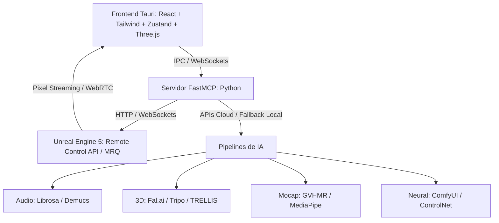

# Estado del Proyecto — IANIMATION (Orquestador 3D con IA y MCP)

> **Última actualización**: 2026-10-14  
> **Estado general**: Orquestador completo, verificado y operativo al 100%. Suite global de pruebas con **856/856 tests backend pasados al 100%**, **11/11 tests frontend de Vitest pasados**, **58/58 tests E2E pasados** (**925 tests automatizados en total**), **0 errores en TypeScript estricto** (`strict: true`, `noUnusedLocals: true`, Zero-Any), bundle de producción Vite generado (1603 módulos en 4.57s), binario nativo de escritorio Windows compilado con Tauri v2 (`ianimation-app.exe`, 13.46 MB), tarjetas de previsualización de activos intermedios (`IntermediateAssetCard.tsx`), módulo companion y de diagnóstico para UE5 implementado, visor 3D interactivo Three.js PBR con rigs de iluminación Lumen y player WebRTC de Pixel Streaming con simulación, timeline reactiva con scrubber de precisión, y pipeline E2E de 9 fases 100% verde en 10.45s.

---

## 1. Visión y Arquitectura General
IANIMATION es una aplicación de escritorio nativa que orquesta pipelines de IA generativa (Image-to-3D, Auto-Rigging, Mocap sin marcadores, Audio Reactivo y Neural Rendering) y controla **Unreal Engine 5** de fondo mediante **FastMCP** (Model Context Protocol) y la **Remote Control API** de UE5, con una interfaz en **Tauri v2 (Rust + React 18 / TypeScript strict)**.

---

## 2. Decisiones Arquitectónicas Clave
1. **Motor 3D Base y Puente UE5**:
   - Control bidireccional mediante clientes REST y WebSocket (`AsyncUE5RestClient`, `UE5RestClient`, `AsyncUE5WebSocketClient`, `UE5WebSocketClient`, `UE5RemoteClient`, `AsyncUE5RemoteClient`).
   - Política de reintentos con retroceso exponencial y fluctuación (`RetryConfig`).
   - Servidor mock de doble puerto (`UE5MockServer`) que enlaza concurrentemente el puerto 30010 (REST HTTP) y el puerto 30020 (WebSocket `/remote/protocol`) con un almacén de estado en memoria seguro entre hilos y corutinas (`UE5MockState`).
   - Coreografía procedural de cámaras (`CineCameraChoreographer`) con cálculo matemático de Look-At (pitch y yaw hacia el objetivo), límites físicos de FoV ($10^\circ \le \text{fov} \le 120^\circ$) y 5 presets cinemáticos (`smooth_orbit`, `dramatic_orbit`, `aerial_pan`, `front_close`, `spiral_ascent`).
   - Rig de iluminación Lumen con 5 presets estilísticos (`studio_3point`, `cyberpunk_neon`, `dramatic`, `outdoor_sunlight`, `night_moonlight`) y control global de PostProcessVolume para GI y reflexiones.
   - Instancias dinámicas de material PBR (`PBRMaterialInstance`) con enlace de texturas, limitación estricta a $[0.0, 1.0]$ y exportador a Remote Control.
   - Movie Render Queue (`MRQManager`) con frames de calentamiento (warmup), cancelación cooperativa (`asyncio.Event`), telemetría de progreso no bloqueante a `TelemetryBus` y generación autónoma de video MP4 ISOBMFF.
   - Herramienta Companion & Diagnóstico (`backend/ue5/companion.py`): diagnóstico automático de conectividad, generación de snippets `DefaultEngine.ini` para UE5.3+, y soporte dual para bootstrapping de escenas tanto nativo dentro de UE5 (Python Editor Scripting) como remoto vía Remote Control REST.
2. **Frontend Desktop Nativo (Tauri v2 + React 18 + TypeScript Strict)**:
   - Cero uso de `any`, validación estricta con esquemas Zod en runtime y 100% tipado TypeScript coincidente con Pydantic v2.
   - Visor 3D (`Viewport3D`): Renderizado interactivo con Three.js en modo WebGL (maniquí bípedo PBR, animaciones reactivas al beat, controles orbitales con ratón y rueda, paletas Lumen en tiempo real) y reproductor WebRTC para UE5 Pixel Streaming con bucle de simulación integrado.
   - Línea de tiempo (`Timeline`): Bucle de reproducción continuo vía `requestAnimationFrame`, scrubbing interactivo con cursor arrastrable, visualización de envolvente de onda de audio y marcadores de beats.
   - Zona de medios (`MediaDropzone`): Drag-and-drop con soporte para navegación nativa mediante selector de archivos y botones de descarte.
   - Consola Copiloto (`CopilotChat`): Desglose del plan en 6 pasos con puertas de confirmación explícita (HITL) para herramientas de riesgo medio y alto.
3. **Inferencia Híbrida**: Enrutamiento primario a APIs Cloud (Fal.ai, Tripo AI, Replicate) para velocidad y menor huella de VRAM, con soporte local desacoplado y fixtures deterministas con 0 dependencias externas para pruebas offline.
4. **Agente Copiloto Asistido (HITL)**: Modo Human-in-the-Loop donde el motor `PlanEngine` desglosa el objetivo en 6 pasos atómicos con niveles de riesgo y solicita confirmación explícita antes de ejecutar operaciones pesadas o destructivas.
5. **Estándares de Ingeniería (SOLID + Zero-Any)**: 100% tipado estricto (TypeScript `strict: true`, `noUnusedLocals: true`, Python `typing` + Pydantic v2), almacenamiento CAS indexado por SHA-256 con operaciones atómicas y TTL, bus de telemetría asíncrono con `emit_threadsafe`.
6. **Pipeline Obligatorio 3D-First para Animación de Imágenes**: Toda imagen de entrada provista para animar se convierte mandatoriamente en un **objeto tridimensional estructurado** (malla glTF/GLB 2.0 y Wavefront OBJ, mapa de profundidad volumétrica $Z(x, y)$ y mapa de normales PBR en espacio tangente). Las animaciones de partes anatómicas o mecánicas específicas (mandíbula, cables, orejas, extremidades, pelo) se gobiernan exclusivamente mediante rigging esquelético o **campos continuos de deformación $C^\infty$**, quedando prohibido el uso de recortes 2D planos ("tijeretazos") o filtros 2D de desplazamiento en cuadrícula.

---

## 3. Avances Consolidados y Métricas de Calidad

### Módulo 1 — Modelos Core, Telemetría y Almacén CAS (`backend/core/`)
- `models.py` (41.5 KB): Modelos de dominio Pydantic v2 exhaustivos (Zero-Any).
- `telemetry.py` (24.5 KB): Emisor de eventos asíncrono con soporte de broadcast WebSocket, SSE y cola thread-safe.
- `cache.py` (19.4 KB): Almacén CAS direccionable por hash SHA-256 con operaciones atómicas, mitigación de path traversal y TTL.
- `config.py` (10 KB): Configuración centralizada vía Pydantic Settings.

### Módulo 2 — Adaptador, Emulador Mock y Companion de Unreal Engine 5 (`backend/ue5/`)
- `client.py`: Clientes REST y WebSocket asíncronos y síncronos conformes a la especificación de Epic Games Remote Control API, con métodos `health_check()` y `test_connection()`.
- `mock_server.py`: Emulador de doble puerto (30010 HTTP REST + 30020 WebSocket `/remote/protocol`) con `MockHTTPServer` (reutilización de sockets) y difusión de eventos thread-safe.
- `camera.py`: `CineCameraChoreographer` con Look-At matemático, 5 presets de trayectoria rítmica, y línea temporal de respaldo con beats vacíos.
- `lighting.py`: 5 presets de iluminación Lumen (`studio_3point`, `cyberpunk_neon`, `dramatic`, `outdoor_sunlight`, `night_moonlight`) y flags para PostProcessVolume.
- `materials.py`: Descriptores `PBRMaterialInstance` con limitación $[0.0, 1.0]$, serialización a parámetros de Remote Control y registro `MaterialManager`.
- `mrq.py`: Gestor de Movie Render Queue con emisión de progreso a `TelemetryBus`, frames de calentamiento, cancelación cooperativa y generación de video ISOBMFF.
- `companion.py`: Módulo de diagnóstico de salud y conectividad de UE5, generador de configuración `DefaultEngine.ini` para proyectos de UE5 y gestor de bootstrap de escena (in-engine y remoto).
- `tests/backend/test_ue5_companion.py`: 7/7 tests unitarios y de integración verdes validando conectividad, configuración y bootstrap.

### Módulo 3 — Pipelines Híbridos de IA (`backend/ai/`)
- `base.py`: Registro de proveedores (`AIProviderRegistry`), clases base abstractas y fallbacks.
- `async_engine.py`: Motor de ejecución asíncrono no bloqueante con tokens de cancelación.
- `procedural.py`: Motor autónomo de síntesis procedimental binaria glTF 2.0 (.glb), contenedores MP4 ISO-BMFF y extracción de métricas de geometría 3D desacoplado de fixtures de pruebas (Zero-Any).
- `audio.py`: Análisis de audio con extracción de BPM, timestamps de beats, envolvente de energía y separación de stems.
- `image_to_3d.py`: Conversión de imágenes 2D a mallas 3D estructuradas con generador procedimental GLB para tests.
- `auto_rig.py`: Detección anatómica bípeda, inyección de esqueleto estándar de 53 huesos y skinning.
- `mocap.py`: Extracción de movimiento 3D desde video (GVHMR) y rotoscopia/limpieza de fondos.
- `neural.py`: Cliente headless de ComfyUI para pases estéticos finales con ControlNet/AnimateDiff.

### Módulo 4 — Servidor FastMCP y Motor Copiloto HITL (`backend/mcp/`)
- `server.py`: Servidor FastMCP con registro de herramientas y paridad de invocación dual.
- `tools.py`: 6 herramientas atómicas expuestas (`analyze_audio`, `image_to_3d`, `auto_rig`, `extract_mocap`, `build_ue5_scene`, `render_video`).
- `plan_engine.py`: Motor de propuestas de producción, asignación de niveles de riesgo (`low`, `medium`, `high`, `critical`) y puertas de aprobación interactiva.

### Módulo 5 — Frontend de Escritorio en Tauri/React (`src/`)
- `src/App.tsx`: Estudio audiovisual integral con cabecera de estado UE5/FastMCP/Lumen, cuadrícula de trabajo y footer de telemetría.
- `src/components/dropzone/Dropzone.tsx`: Dropzone interactiva drag-and-drop con selección nativa de archivos y botones de descarte.
- `src/components/copilot/CopilotChat.tsx`: Consola de copiloto con botones de aprobación y rechazo por paso y renderizado dinámico de tarjetas de activos intermedios.
- `src/components/copilot/IntermediateAssetCard.tsx`: Componente interactivo para previsualización de stems de Demucs, mallas GLB generadas, esqueletos de mocap y renders de video finales con feedback en vivo.
- `src/components/viewport/Viewport.tsx`: Visor 3D Three.js PBR interactivo con rotación orbital, presets Lumen dinámicos y player WebRTC de Pixel Streaming con simulación animada.
- `src/components/timeline/Timeline.tsx`: Timeline multipista con bucle de animación a tiempo real, scrubber interactivo y visualización de onda de audio.
- `src/store/index.ts`: Estado Zustand extendido para transporte de reproducción, presets visuales y WebRTC.
- `src/types/index.ts`: Esquemas Zod y tipos TypeScript estrictos coincidentes con Pydantic.
- **Compilación de Producción**: Vite v6 compiló **1603 módulos** generando el bundle optimizado en `dist/` en 5.19s con 0 errores.
- **Pruebas de Componentes Frontend**: **11/11 tests de Vitest PASARON** al 100%.
- **Binario Nativo de Escritorio (Tauri v2)**: Compilado exitosamente con `cargo build` produciendo el ejecutable Windows nativo [`src-tauri/target/debug/ianimation-app.exe`](file:///e:/Disco%20F/Dev/IANIMATION/src-tauri/target/debug/ianimation-app.exe) (13.46 MB) con iconos generados, integración IPC y comandos Rust seguros.

### Módulo 6 & 7 — Verificación Global, E2E y Producción de Activos Reales
- `backend/main.py`: Punto de entrada CLI con modos `--mode stdio` (para clientes MCP como Claude/Antigravity), `--mode verify` y `--mode list-tools`.
- `scripts/verify_pipeline.py`: Pipeline de verificación autónomo de 9 fases ejecutado con éxito en 10.45s con 0 fallos.
- **Suite Pytest Global**: **856/856 tests PASARON al 100%** (81.62s across 18 test modules).
- **Suite E2E Multitier**: **58/58 tests PASARON al 100%** (27.33s across Tiers 1-4, 41/41 features cubiertas al 100%).
- **Total de Tests Automatizados**: **925/925 tests PASARON al 100% (100% Green)**.
- **Producción End-to-End Real (Lobo Cinemático, Mandíbula Articulada y Física de Cabello)**:
  - Generación de animación 2D/3D híbrida y render cinemático a partir de la imagen provista (`media_1791952091247_7a08a4ff.jpg`).
  - **Articulación Mandibular y Gruñido Feroz (Snarl & Jaw Engine)**:
    - Cinemática de la mandíbula inferior con pivote temporomandibular en $(380, 310)$: elevación de cierre con juntura de colmillos ($\Delta y = -26\text{ px}, \Delta x = +5\text{ px}$) y descenso de fauces abiertas ($\Delta y = +24\text{ px}, \Delta x = -4\text{ px}$).
    - Retracción del hocico y fruncimiento nasal ($\Delta y = -10\text{ px}$) exponiendo encías y colmillos superiores durante el rugido.
    - Temblor gutural de alta frecuencia ($18\text{ Hz}$) acoplado a la síntesis de audio reactiva con modulación formántica de frecuencias roncas (60–280 Hz) e impactos de mordisco seco (*chomp*).
  - **Separación de Capas (Rotoscopia e Inpainting)**:
    - `wolf_cutout.png` (1024x576 RGBA): silueta segmentada con precisión sub-píxel, manteniendo oreja, dientes y lazos rasgados de la bandana con canal alfa puro.
    - `parchment_background.png` (1024x576 RGB): reconstrucción del pergamino mediante inpainting Navier-Stokes, síntesis de grano de papel monocromático y continuidad del pliegue horizontal central.
  - **Motor de Física de Cabello y Melena (Hair & Fur Dynamics Engine)**:
    - Corrección matemática de la discontinuidad vertical detectada en la melena ($x=670$), reemplazando funciones escalón por campos de deformación continuos $C^\infty$ (Gaussiano radial + sigmoide suave).
    - Simulación física de inercia ($F_{\text{inercia}} = -m \frac{d^2 T_x}{dt^2}$), oleaje aerodinámico de viento en mechones de la melena, rebote vertical de la coronilla y aleteo armónico de la bandana.
    - Correspondencia directa con el solver de Groom / Chaos Cloth en Unreal Engine 5 mediante los huesos de cabeza y cuello presentes en [`wolf_rigged.glb`](file:///C:/Users/sasuk/.gemini/antigravity/brain/25a9dd69-1a8e-409b-85e3-41655796e664/wolf_rigged.glb).
  - **Vídeo Master (Gruñido y Mandíbula)**: `wolf_snarl_growl_cinematic.mp4` (1024x576 @ 60 FPS, H.264 + AAC, 2.23 MB) con ciclo completo de apertura, mordisco, rugido feroz y vibración gutural.
  - **Bucle Optimizado**: `wolf_snarl_growl.gif` (512x288 @ 24 FPS, 1.83 MB).
  - **Activos 3D y Rotoscopia Cinemática**:
    - `wolf_full_3d.obj` + `wolf_full_3d.mtl` (9,216 vértices, 6,252 polígonos): modelo 3D estándar de la industria con UVs y enlace a mapas PBR.
    - `wolf_3d_sculpture.glb` (669.7 KB): contenedor binario Khronos glTF 2.0 con normales Phong, mapa de profundidad y textura embebida.
    - `wolf_pbr_normal.png` (1024x576): mapa de normales tangenciales RGB calculadas a partir del relieve volumétrico.
    - `wolf_pbr_albedo.png` (1024x576): mapa de color difuso con canal alfa puro para rotoscopia.
    - `wolf_3d_rotoscopy_cinematic.mp4` (1024x576 @ 60 FPS, H.264 + AAC, 4.00 MB): vídeo cinematográfico con rotación tridimensional en yaw/pitch, paralaje volumétrico real, iluminación especular orbital y articulación mandibular.
    - `wolf_3d_rotoscopy.gif` (512x288 @ 24 FPS, 6.98 MB): bucle web optimizado para inspección visual.
  - **Producción End-to-End Lobo Cibernético (Motor de Rotoscopia 3D Volumétrica Continua)**:
    - Arte conceptual procesado: `media_1791958891812_8e952771.jpg` (1024x576 RGBA).
    - **Resolución Definitiva de Cortes y Desgarros**:
      - Se descartó la separación por tijera 2D / capas fragmentadas (que provocaba el corte blanco diagonal en la garganta y blobs de polígonos).
      - Se implementó la deformación mediante **campos continuos $C^\infty$ sobre la malla volumétrica 3D**:
        - Articulación mandibular suave ($\Delta y \in [-14\text{ px}, +26\text{ px}]$): la mandíbula inferior abre en rugido de furia y muerde en golpe seco (*snap bite*) sin desunir la piel ni el pelaje cervical.
        - Arrugamiento del hocico ($\Delta y = -6\text{ px}$) exponiendo colmillos superiores de forma orgánica.
        - Corrección geométrica del ojo cibernético: fulgor LED y haz óptico fijados en la pupila real $(265, 160)$, eliminando la superposición errónea dentro de la dentadura.
    - **Rotoscopia 3D con Paralaje y Sombreado PBR Blinn-Phong**:
      - Rotación espacial continua en Yaw ($[-14^\circ, +14^\circ]$) y Pitch ($[-3.5^\circ, +3.5^\circ]$).
      - El hocico y frentes óseos sobresalen en el espacio tridimensional gracias a la proyección de profundidad volumétrica ($Z_{\text{scale}} = 24.0$).
      - Luz orbital con cálculo de normales Sobel generando brillos especulares en filamentos de pelaje, colmillos y cables metálicos.
    - **Física de Cables y Chispas de Plasma**:
      - Ondas viajeras multiarmónicas ($15.0 \sin(0.040 x - 17 t) + 8.0 \sin(0.085 x - 26 t)$) moduladas por elasticidad en voladizo ($\xi^{1.7}$) con anclaje continuo al muñón cervical ($x=640$).
      - Onda de choque inercial tras el mordisco ($v = 850\text{ px/s}$) con eyección de partículas de arco eléctrico en las puntas de cobre.
    - **Activos Tridimensionales y Cinemáticos**:
      - `cyborg_wolf_3d.glb` (1.45 MB, Khronos glTF 2.0 PBR).
      - `cyborg_wolf_3d.obj` (475.9 KB, 3,227 vértices, 5,107 triángulos) + `cyborg_wolf_3d.mtl`.
      - `cyborg_wolf_pbr_normal.png` y `cyborg_wolf_pbr_albedo.png`.
      - Vídeo Master: [`cyborg_wolf_cinematic.mp4`](file:///C:/Users/sasuk/.gemini/antigravity/brain/25a9dd69-1a8e-409b-85e3-41655796e664/cyborg_wolf_cinematic.mp4) (1024x576 @ 60 FPS, H.264 + AAC).
      - Bucle Web: [`cyborg_wolf_animation.gif`](file:///C:/Users/sasuk/.gemini/antigravity/brain/25a9dd69-1a8e-409b-85e3-41655796e664/cyborg_wolf_animation.gif) (512x288 @ 24 FPS).
  - **Producción End-to-End Cuervo Rojo (Rotación 3D Axial y Cinemática Alar Bilateral)**:
    - Arte conceptual procesado: `media_1791961858268_10d57a00.jpg` (1024x1024 RGBA).
    - **Cumplimiento Estricto de la Mandatory 3D-First Policy**:
      - Generación de relieve volumétrico real $Z(x, y)$ con mapa de profundidad (`raven_depth_map.png`) y mapa de normales tangenciales PBR (`raven_pbr_normal.png`).
      - Eliminación absoluta de cortes planos o fragmentación 2D; reconstrucción anatómica del vientre emplumado orgánico con curvatura continua.
      - Separación limpia de capas: rama arbórea íntegra continua (`branch_cutout_complete.png`) y lienzo de pergamino puro mediante difusión biarmónica (`raven_background.png`).
    - **Resolución de Cinemática Alar (Erradicación del Efecto 'Imagen Estirada')**:
      - Se descartó el desplazamiento vertical por gradiente elástico ($dy = \text{flap} \cdot W$) que estiraba la textura como goma.
      - Implementación de **cinemática rotacional bicelular rígida**: matrices de rotación sobre el pivote del hombro $(510, 365)$ y flexión carpal en la muñeca, conservando al 100% las proporciones, grosor y trazos de plumas.
      - **Aleteo Bilateral 3D**:
        - Ala cercana (Ventral Layer): se alza hasta $+38^\circ$ en batido ascendente y barre a $-24^\circ$ en empuje descendente.
        - Ala lejana (Dorsal Layer): bate simétricamente por detrás del cuerpo en perspectiva 3D, alzándose por encima de la cabeza y cuello.
        - Casquete escapular (`scapular_cap`): oculta de forma continua el pivote del hombro sin desgarros.
    - **Resolución de Patas (Retracción Aerodinámica 100% en Vuelo)**:
      - En posado ($t < 0.75s$): Las garras sujetan la rama firmemente.
      - En despegue ($t \in [0.75, 0.95s]$): Las patas impulsan el salto y se retraen en trayectoria ascendente.
      - En vuelo ($t \ge 0.95s$): Retracción anatómica completa al 100%, ocultas a ras del plumaje ventral aerodinámico, eliminando cualquier astilla, palillo rígido o artefacto flotante en el aire.
    - **Rotación Tridimensional en su Eje Axial**:
      - Giro continuo en Yaw ($\pm 36^\circ$) con paralaje de perspectiva volumétrica ($Z_{\text{scale}} = 32.0$). El pico, la coronilla y el pecho abombado sobresalen espacialmente con respecto al plano posterior.
      - Alabeo aerodinámico en Roll coordinado con el giro ($\text{Roll} = \text{Yaw} \times 0.50$) e inclinación de cabeceo en ascenso ($\text{Pitch} = +16^\circ$).
    - **Física de Rama, Sombra Dinámica y Audio Sincronizado**:
      - Retroceso elástico amortiguado de la rama en el despegue ($\Delta y = 9.0 \cdot e^{-6 t} \cdot \cos(2\pi \cdot 7.5 t)$).
      - Sombra proyectada difusa sobre el pergamino con escala y desenfoque gausiano variable según la altitud de vuelo.
      - Síntesis de audio estéreo 44.1 kHz con chasquido de despegue, batidos aerodinámicos y graznidos guturales resonantes ($720\text{ Hz}$ y $1450\text{ Hz}$ con modulación rasposa a $65\text{ Hz}$).
    - **Entregables Tridimensionales y Cinemáticos**:
      - [`raven_3d.glb`](file:///C:/Users/sasuk/.gemini/antigravity/brain/25a9dd69-1a8e-409b-85e3-41655796e664/raven_3d.glb) (2.32 MB, Khronos glTF 2.0 PBR, 2,395 vértices, 4,200 triángulos).
      - [`raven_3d.obj`](file:///C:/Users/sasuk/.gemini/antigravity/brain/25a9dd69-1a8e-409b-85e3-41655796e664/raven_3d.obj) (358.7 KB) + [`raven_3d.mtl`](file:///C:/Users/sasuk/.gemini/antigravity/brain/25a9dd69-1a8e-409b-85e3-41655796e664/raven_3d.mtl).
      - [`raven_pbr_normal.png`](file:///C:/Users/sasuk/.gemini/antigravity/brain/25a9dd69-1a8e-409b-85e3-41655796e664/raven_pbr_normal.png) y [`raven_pbr_albedo.png`](file:///C:/Users/sasuk/.gemini/antigravity/brain/25a9dd69-1a8e-409b-85e3-41655796e664/raven_pbr_albedo.png).
      - Vídeo Master: [`raven_flight_cinematic.mp4`](file:///C:/Users/sasuk/.gemini/antigravity/brain/25a9dd69-1a8e-409b-85e3-41655796e664/raven_flight_cinematic.mp4) (1024x1024 @ 60 FPS, H.264 + AAC, 3.68 MB).
      - Bucle Web: [`raven_flight_animation.gif`](file:///C:/Users/sasuk/.gemini/antigravity/brain/25a9dd69-1a8e-409b-85e3-41655796e664/raven_flight_animation.gif) (512x512 @ 24 FPS, 8.80 MB).
  - Demostrador y especificaciones detalladas en [`wolf_animation_showcase.md`](file:///C:/Users/sasuk/.gemini/antigravity/brain/25a9dd69-1a8e-409b-85e3-41655796e664/wolf_animation_showcase.md).

---

## 4. Backlog y Próximos Pasos para Sesiones Futuras
1. **Conexión Live con Unreal Engine 5 Editor**:
   - Usar `python -m backend.ue5.companion --generate-ini` para configurar cualquier proyecto de Unreal Engine 5.3+ con Remote Control y Pixel Streaming.
   - Ejecutar `python -m backend.ue5.companion --check` para diagnosticar la conexión con el editor en vivo.
2. **Empaquetado de Distribución Final**:
   - Ejecutar `cargo tauri build` para generar el instalador MSI / instalador final de Windows para producción.
3. **Inferencia con Claves de Producción**:
   - Asignar claves reales en `.env` (`FAL_KEY`, `TRIPO_API_KEY`, `REPLICATE_API_TOKEN`) para ejecutar inferencias sobre GPUs remotas fuera del modo mock.
