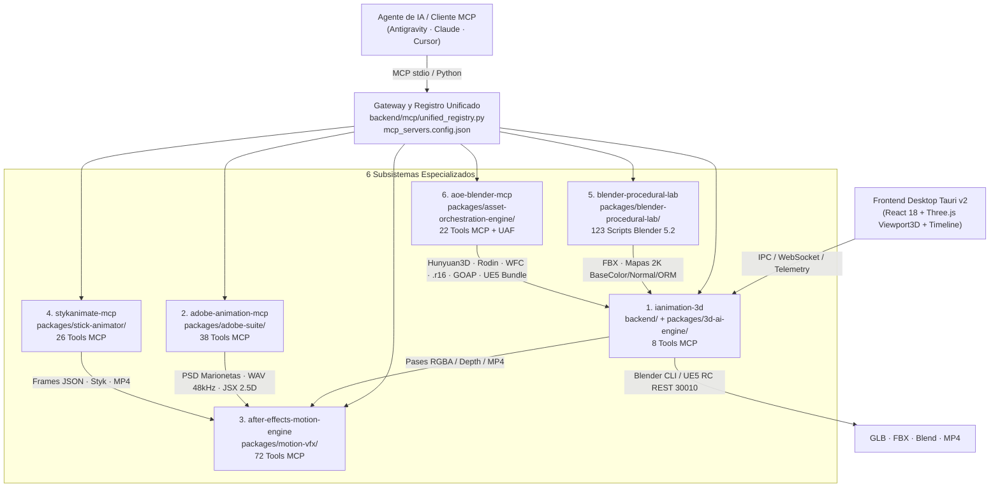

# Arquitectura Unificada del Monorepo `IANIMATION`

> **Versión del Monorepo**: 1.1.0 Unificado · **Subsistemas**: 6 dominios desacoplados · **Herramientas MCP**: 166 · **Generadores Procedurales Blender**: 123.

---

## 1. Visión Arquitectónica por Dominios

El monorepo **`IANIMATION`** aplica **Arquitectura Hexagonal + Principios SOLID** para unificar seis motores complementarios de animación, renderizado 3D, orquestación determinista de mundos/activos, post-producción VFX y rigging 2D bajo una sola capa de descubrimiento y contratos estrictos:

---

## 2. Desglose Técnico de Capas y Responsabilidades

### 2.1 Dominio 1: `ianimation-3d` (`backend/` + `packages/3d-ai-engine/`)
Orquestador central escrito en **Python >=3.10 + Pydantic v2** (100% *Zero-Any*).
- **Contratos y Estado ([`backend/core/`](../backend/core/))**: Esquemas de dominio (`StrictBaseModel`), almacenamiento direccionable por contenido (`SHA-256 CAS`), configuración centralizada y bus de telemetría thread-safe/async.
- **Pipelines 3D IA ([`backend/ai/`](../backend/ai/))**:
  - Reconstrucción volumétrica 3D (`image_to_3d.py`, `neural_3d_engine.py`, `volumetric_3d.py`, `defringe.py`).
  - Retopología *Quad Remeshing* y baking PBR High-to-Low Poly (`quad_remesher.py`, `pbr_baker.py`).
  - Rigging anatómico, dinámicas secundarias y cinemática inversa analítica (`auto_rig.py`, `character_dynamics.py`, `advanced_kinematics.py`).
  - Segmentación modular rígida con isometría euclidiana estricta $SE(3)$ ($\sigma^2 < 10^{-10}$, `modular_articulation.py`, `component_decomposer.py`).
- **Adaptadores 3D ([`backend/engines/base.py`](../backend/engines/base.py), [`backend/blender/`](../backend/blender/), [`backend/ue5/`](../backend/ue5/))**: Contratos intercambiables `Base3DEngineAdapter` para **Blender 5.2.0 LTS Headless** y **Unreal Engine 5 Remote Control API / Movie Render Queue**.
- **Planificación y Descubrimiento ([`backend/mcp/`](../backend/mcp/))**: `PlanEngine` (HITL 6 pasos), `FastMCPServer`, `unified_mcp_server` y `UnifiedAnimationRegistry`.

### 2.2 Dominio 2: `adobe-animation-mcp` (`packages/adobe-suite/`)
Motor **Node.js / TypeScript** orientado a producción de animación 2D y voz sincronizada.
- **Character Animator Rigging (`CharacterAnimatorDeepEngine`, `PuppetBuilder`, `VisemeDrawer`)**: Síntesis headless de archivos `.psd` estructurados con jerarquía `+Head`, parallax 2.5D, **14 visemas bucales**, Head Turner multi-ángulo (3/5 vistas), etiquetas físicas (`Dangle`, `Draggable`, `Fixed`), disparadores emocionales y *Puppet Doctor* (auditoría 0-100 y auto-reparación).
- **Voz Neural HD y Lip-Sync (`NeuralSpeechEngine`, `WavGenerator`, `edge_synth.py`)**: Generación de audio WAV 48kHz 16-bit PCM multi-acento y exportación de cues de visemas a JSON, CSV y ExtendScript `.jsx`.
- **Puente Vectorial & 2.5D**: Automatización JSX de Adobe Illustrator (`ai_*`), escenarios 2.5D con paralaje en After Effects (`ae_*`), y fondos/bocetos Grease Pencil en Blender (`blender_*`).

### 2.3 Dominio 3: `after-effects-motion-engine` (`packages/motion-vfx/`)
Plataforma **Node.js / TypeScript** con representación intermedia canónica (IR), persistencia con revisiones inmutables y compilador a ExtendScript (`.jsx`) para Adobe After Effects.
- **Núcleo Cinematográfico y VFX (29 fases acumuladas)**:
  - **Óptica y Espacial**: `apply_snap_zooms_to_timeline`, `apply_fisheye_optics`, `compile_dolly_zoom`, `apply_snorricam_body_lock`, `apply_infinite_zoom_portal`.
  - **Temporal y Ritmo**: `apply_posterize_time`, `compile_speed_ramp_to_beat`, `apply_machine_gun_flash_cuts`, `apply_blackout_vacuum_drop`.
  - **Estética Fílmica y Fotónica**: `apply_film_grain_and_halation`, `apply_auteur_color_grading`, `apply_shutter_drag_echo`, `apply_anamorphic_streak_flare`, `apply_flir_thermal_vision`.
  - **Tipografía Cinética Editorial**: `apply_brutalist_kinetic_title`, `apply_liquid_chrome_text_effect`, `compose_text_behind_subject`.
  - **Mixed-Media y Stem Kinetics**: `apply_manga_impact_frame`, `apply_procedural_speed_lines`, `apply_film_sprocket_holes`, `apply_audio_reactive_physics`, `apply_datamosh_pframe_glitch`.
- **Producción Editorial y Vlog Autónomo**: `vlog_produce` (22 fases), transcripción local (`transcribe_local_audio`), `detect_viral_clips`, compilador `editorial_compile_data_visualization` y auditoría `editorial_run_qa`.

### 2.4 Dominio 4: `stykanimate-mcp` (`packages/stick-animator/`)
Motor **JavaScript (ESM Node.js >=20) + Códec Python** completamente headless (cero GPU/navegador requerido).
- Opera sobre el árbol de documento nativo de **StykAnimate** (`.styk`, `.stkz`, `.stykmov`) y convierte bidireccionalmente desde **Pivot Animator** (`.piv`, `.stk`) mediante su códec Python integrado ([`stykanimate-mcp/py/`](../packages/stick-animator/stykanimate-mcp/py/)).
- Incluye resolutor analítico de Cinemática Inversa (`pose_ik_set`, `pose_set_ik`), historial undo/redo transaccional y scripts CLI en [`cli/`](../packages/stick-animator/cli/) para exportar animaciones interactivas HTML5 o videos MP4 (`render_mp4.py`).

### 2.5 Dominio 5: `blender-procedural-lab` (`packages/blender-procedural-lab/`)
Banco de ingeniería 3D y materiales PBR basado en **Blender 5.2 LTS (`bpy` / `bmesh`)** + **PIL/NumPy**.
- **Materiales y Texturas ([`generators/pbr_textures_and_benches/`](../packages/blender-procedural-lab/generators/pbr_textures_and_benches/))**: Generadores de mapas PBR 2048x2048 (`BaseColor`, `Normal` DirectX/OpenGL y canales empaquetados `ORM` — Occlusion/Roughness/Metallic) y *Material Test Bench Pro V5* con Shader Balls y placa identificadora 3D.
- **Personajes y Solvers IK ([`generators/characters_and_rigs/`](../packages/blender-procedural-lab/generators/characters_and_rigs/), [`generators/animations_and_ik/`](../packages/blender-procedural-lab/generators/animations_and_ik/))**: Generadores A-Pose UE5, riggeo BMesh determinista, ciclos de locomoción/combate 3D y solvers bimanuales.
- **Arquitectura Modular y Catálogos ([`generators/modular_kits_and_props/`](../packages/blender-procedural-lab/generators/modular_kits_and_props/), [`exporters/`](../packages/blender-procedural-lab/exporters/))**: Kit de 90 activos modulares en 5 temáticas, 50 props maestros, bestiario de 10 entidades, arsenal de 20 armas y exportadores por lote a FBX UE5.

### 2.6 Dominio 6: `aoe-blender-mcp` (`packages/asset-orchestration-engine/`)
Motor **Python >=3.10 + Blender MCP + Unreal Engine 5** que integra el **Asset Orchestration Engine (Fases F1–F80)** y la **Universal Asset Factory (`UAF-81.0–81.92`)**:
- **Orquestador Determinista de Producción (`src/production_orchestration`)**: Pipeline de 19 etapas que compila intenciones en lenguaje natural a especificaciones geométricas (`SemanticMeshSpec`, sockets, grafos PBR), evalúa presupuesto poligonal y ejecuta crítica/auto-reparación booleana y manifold.
- **Universal Asset Factory (`src/uaf/`)**:
  - `procedural_level` (`UAF-81.90`): Wave Function Collapse 2D/3D con entropía de Shannon, ciclos Lock-and-Key sin softlocks, Mission DAG y AI Pacing Director.
  - `macro_landscape` (`UAF-81.91`): Terrenos multi-octava con erosión hidráulica y térmica dual, biomas de Whittaker, splines de ríos/caminos y exportación binaria `.r16` de 16 bits para Unreal Engine 5 Landscape.
  - `multi_agent_npc` (`UAF-81.92`): IA cognitiva GOAP ($A^*$), maniobras tácticas de escuadrón (Bounding Overwatch, Flanking, Breach & Clear), percepción sensorial dual y exportación a StateTree/BehaviorTree de UE5.
- **Blender MCP Bridge (`mcp/blender/blender_mcp_addon.py` + 22 JSON Schemas)**: Control en vivo de Blender por socket y generación/descarga directa desde **Tencent Hunyuan3D**, **Hyper3D Rodin**, **PolyHaven** y **Sketchfab**.

---

## 3. Contratos de Interoperabilidad entre Motores

La cohesión del monorepo descansa en **formatos de intercambio estándar** (evitando acoplamientos internos entre runtimes Python y Node.js):

| Origen | Destino | Artefacto / Formato Estándar de Intercambio |
| :--- | :--- | :--- |
| `blender-procedural-lab` | `ianimation-3d` (UE5 / Blender) | Mallas `.glb` / `.fbx` (con colisiones `UCX_*`), texturas PBR 2K (`_BaseColor`, `_Normal`, `_ORM`) |
| `ianimation-3d` | `after-effects-motion-engine` | Secuencias `.mp4`, pases RGBA/Z-Depth PNG para compositing detrás de sujeto o post-VFX |
| `adobe-animation-mcp` | `after-effects-motion-engine` | Marionetas `.psd` / `.ai`, audio WAV 48kHz 16-bit PCM, `SceneManifest` JSON y scripts `.jsx` |
| `stick-animator` | `after-effects-motion-engine` / `ianimation-3d` | Videos `.mp4`, trazas `frames.json` y referencias de poses IK |
| Todos los paquetes MCP | Agente de IA / Orquestador | JSON sobre protocolo **MCP (stdio)** validado estrictamente con Zod / Pydantic v2 |
