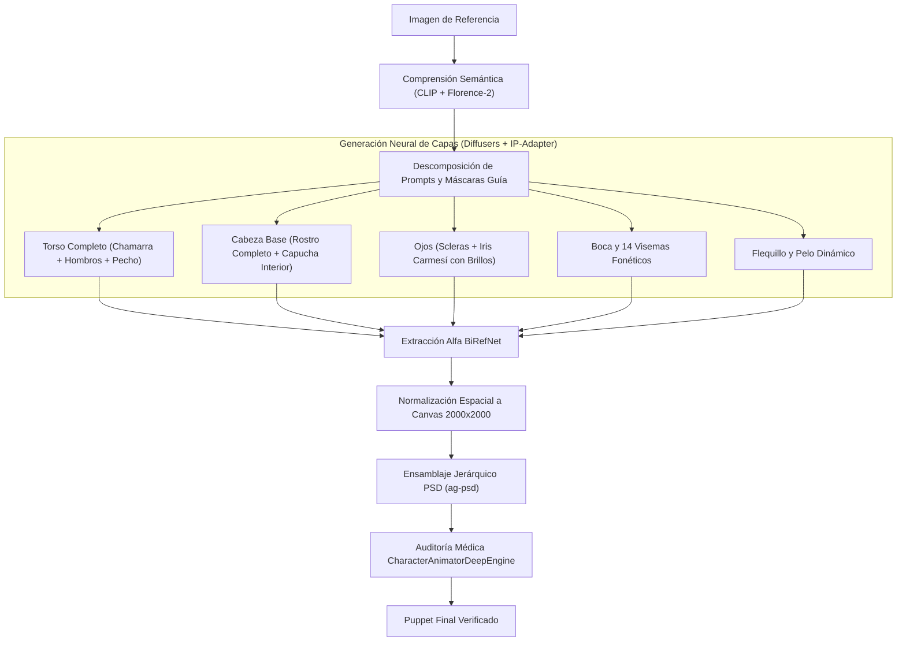

# Roadmap: Reconstrucción Neural Integral del Personaje para Adobe Character Animator

Este documento define la arquitectura y el plan de implementación explícito para reconstruir la marioneta anime cyberpunk **desde cero mediante redes neuronales generativas y de visión**, eliminando definitivamente la dependencia de cortar, pegar o parchar el bitmap 2D plano original.

---

## 1. Diagnóstico del Error Actual (`media_1789132662738.png`)

La captura confirma la falla estructural del enfoque de recorte:
1. **Inversión de Oclusión**: El cuello de la capa `Torso` se superpone sobre la cara hasta la nariz como una máscara blanca rígida.
2. **Dependencia de Bitmap Plano**: Al no existir información 3D u ocluida en la ilustración original, cualquier deformación en Character Animator rompe la continuidad visual.
3. **Solución Requerida**: Un pipeline donde redes neuronales generativas entiendan la semántica del personaje (chica anime cyberpunk, cabello verde azulado, ojos carmesí, capucha blanca, chamarra techwear con cuello alto) y generen cada elemento como una ilustración completa, limpia e independiente con sus regiones ocultas completamente resueltas.

---

## 2. Stack Tecnológico y Librerías

| Componente | Librería / Herramienta | Función Técnica |
|---|---|---|
| **Motor Neuronal Base** | `torch` (CUDA) / `torchvision` | Aceleración de tensores en GPU NVIDIA RTX 5070 (12 GB VRAM). |
| **Comprensión Semántica** | `transformers` (CLIP / Florence-2) | Extracción de tokens visuales y descriptores anatómicos del personaje. |
| **Síntesis Generativa** | `diffusers` (SDXL Anime / ControlNet / IP-Adapter) | Generación desde cero de las partes anatómicas sin oclusiones. |
| **Aislamiento Alfa HD** | `rembg` / `birefnet` (BiRefNet) | Segmentación de fondo y extracción de canal alfa subpíxel sin halos. |
| **Inpainting & Síntesis Ocluida** | `onnxruntime-gpu` / `LaMa Large` | Reconstrucción de volúmenes anatómicos ocultos tras la ropa/cabello. |
| **Vectorización y Limpieza** | `opencv-python`, `pillow`, `scikit-image` | Normalización espacial, rasterizado y alineación de visemas. |
| **Ensamblaje PSD** | `ag-psd` (Node.js) | Escritura de jerarquías, grupos independientes (`+`), pivotes y metadatos. |
| **Auditoría de Rigging** | `CharacterAnimatorDeepEngine` (TypeScript) | Validación médica de los 14 visemas, eye-tracking y físicas Dangle. |

---

## 3. Pipeline de Reconstrucción Neural



---

## 4. Fases de Implementación

### Fase 1: Entorno y Habilitación de GPU
- Configurar PyTorch con soporte CUDA 12.x / cuDNN para la RTX 5070.
- Verificar asignación de memoria VRAM y rendimiento de inferencia.

### Fase 2: Comprensión y Acondicionamiento Semántico
- Analizar la referencia visual para extraer:
  - Paleta exacta (piel, cabello `#155a68`, iris `#b40f2d`, chamarra `#f3f4f5`).
  - Relación de aspecto y proporciones de rasgos faciales anime.
- Generar acondicionamientos (ControlNet Openpose / Lineart / IP-Adapter image prompt).

### Fase 3: Generación Autónoma de Piezas Anatómicas
- **Torso**: Generar la chamarra completa con el cuello ubicado *detrás* del plano de la barbilla.
- **Cabeza (+Head)**: Generar el rostro completo desde la frente hasta la base del cuello, sin interferencia de la tela exterior.
- **Capucha**: Separar la capucha en capa posterior (`Hood_Back`) y capa anterior, permitiendo rotación sin colisión.
- **Ojos (+Left Eye, +Right Eye)**:
  - Generar escleras con sombreado anime suave.
  - Generar iris carmesí en alta resolución con specular highlights concéntricos.
  - Generar pestañas superiores en capa separada para enmarcar el iris.
- **Flequillo (`Hair Bangs Dangle`)**: Generar mechones limpios con canal alfa para física reactiva.

### Fase 4: Generación de 14 Visemas de Sincronización Labial
- Producir las 14 formas fonéticas estándar de Adobe Character Animator:
  `Neutral`, `Ah`, `D`, `Ee`, `F`, `L`, `M`, `Oh`, `R`, `S`, `Uh`, `W-Oo`, `Smile`, `Surprised`.
- Mantener consistencia de estilo y grosor de línea anime con el rostro base.

### Fase 5: Rigging y Estructuración en Adobe Character Animator
- Jerarquía estricta de capas:
  ```text
  CyberGirl
  ├── +Head (Pivote calibrado en la base del cuello)
  │   ├── Hair Bangs Dangle
  │   ├── Left Eyebrow / Right Eyebrow
  │   ├── +Left Eye > [Left Eyelash, Left Pupil, Left Eyeball]
  │   ├── +Right Eye > [Right Eyelash, Right Pupil, Right Eyeball]
  │   ├── Nose
  │   ├── Mouth > [14 capas de visemas, Neutral visible]
  │   ├── Emotions > [Blush (b), Sweatdrop (w), AnimeVein (v)]
  │   ├── Head_Base (Rostro y cuello íntegros)
  │   └── Hood_Back (Fondo interior de la capucha)
  └── Body
      └── Torso (Chamarra completa detrás del cuello)
  ```
- Colocar etiquetas y manejadores explícitos: `Neck`, `Head`, `Origin`, `Dangle`.

### Fase 6: Validación y Auditoría Médica
- Ejecutar `CharacterAnimatorDeepEngine.auditPuppetDeep`.
- Verificar puntaje `>= 90/100`.
- Comprobar visualmente rotación de -15° a +15° y simulación de lipsync sin cruce de planos.
