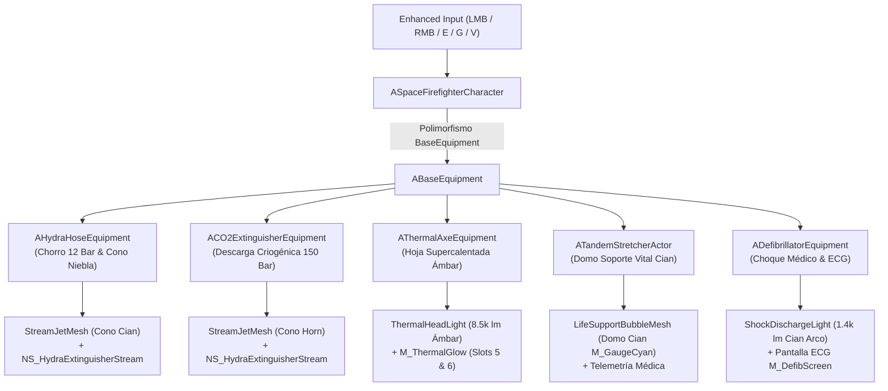

# Arquitectura Técnica: Efectos Visuales, Animaciones y Estética Cartoon/Industrial del Arsenal
## Documento Técnico Oficial — Astra Hazard: Rescue Squad
**Alineación GDD:** §8 (Herramientas, Armas y Equipo de Extinción / Demolición)  
**Normas de Ingeniería:** [GEMINI.md](../../GEMINI.md) (Clean Code, SOLID, Tipado Estricto, Fail-Fast y Verificación Visual Empírica)

---

## 1. Propósito y Alcance

Este documento describe la arquitectura, sincronización de efectos visuales (VFX Niagara, mallas volumétricas cónicas y mallas de soporte vital), animaciones y coherencia estética **Cartoon/Industrial** aplicada a todo el arsenal de herramientas y equipo de rescate del bombero espacial:
1. **`BP_HydraHose` (`AHydraHoseEquipment`)**: Cañón modular de manguera extintora a alta presión (12 Bar), chorro criogénico continuo y cono de niebla supresora.
2. **`BP_CO2Extinguisher` (`ACO2ExtinguisherEquipment`)**: Extintor portátil de dióxido de carbono criogénico a 150 Bar para supresión química y eléctrica.
3. **`BP_ThermalAxe` (`AThermalAxeEquipment`)**: Hacha táctica de brecha con hoja de corte supercalentada a plasma ámbar (2.5x daño cinético/térmico contra escombros).
4. **`BP_TandemStretcher` (`ATandemStretcherActor`)**: Camilla táctica tándem para evacuación rápida y cápsula sellada de soporte vital *in-situ*.
5. **`BP_Defibrillator` (`ADefibrillatorEquipment`)**: Unidad médica táctica de reanimación por choque bifásico sincronizado con ECG y arco eléctrico diegético.

El objetivo principal es garantizar que cada arma/herramienta proporcione un feedback diegético inmediato, legible y táctil al usuario tanto en tercera persona (3P) como en primera persona (1P), respetando la dirección de arte estilizada (paleta hazmat/emergencia: amarillo rescate, rojo industrial, cian criogénico y titanio mate, con cel-shading limpio y cero ruido visual fotorrealista).

---

## 2. Contratos e Interfaces Técnicas

### 2.1 Manguera Pesada Hydra (`AHydraHoseEquipment`)
- **Herencia:** `ABaseEquipment` $\rightarrow$ `AActor`.
- **Componentes Visuales y Efectos:**
  - `NozzleArrow` (`UArrowComponent`): Punto autoritativo de proyección en la boquilla frontal (`-46.0 cm`, `Yaw=180.0°`).
  - `StreamJetMeshComponent` (`UStaticMeshComponent`): Malla volumétrica cónica estilizada (`/Engine/BasicShapes/Cone`) con material `W_Cryo_Cyan`.
  - `StreamNiagaraComponent` (`UNiagaraComponent`): Sistema de partículas `/Game/VFX/Niagara/NS_HydraExtinguisherStream`.
- **Métodos Clave:**
  - `ActivateTool(ACharacter* User)`: Inicia el chorro criogénico a 12 Bar, activa el cono volumétrico y el emisor Niagara.
  - `DeactivateTool(ACharacter* User)`: Detiene el flujo y oculta la geometría del chorro.
  - `StartSecondaryAction(ACharacter* User)`: Alterna entre chorro concentrado (semiángulo $15^\circ$, alcance 2400 cm) y cono de niebla supresora (semiángulo $45^\circ$, alcance 1600 cm).

### 2.2 Extintor Portátil de CO2 (`ACO2ExtinguisherEquipment`)
- **Herencia:** `ABaseEquipment` $\rightarrow$ `AActor`.
- **Componentes Visuales y Efectos:**
  - `NozzleArrow` (`UArrowComponent`): Situado en la tobera difusora (Horn) a `(0.0, 25.0, 65.0)` orientada a `Yaw=90.0°`.
  - `StreamJetMeshComponent` (`UStaticMeshComponent`): Cono volumétrico de gas criogénico que emerge del difusor.
  - `StreamNiagaraComponent` (`UNiagaraComponent`): Nube de gas a presión subcero.
- **Métodos Clave:**
  - `StartPrimaryAction(ACharacter* User)`: Descarga el gas criogénico, activa el cono visual y consume $15.0\text{ Bar/s}$.
  - `StopPrimaryAction(ACharacter* User)`: Cierra la válvula de descarga.
  - `StartSecondaryAction(ACharacter* User)`: Modo de inspección diegética del manómetro analógico.

### 2.3 Hacha Térmica de Choque (`AThermalAxeEquipment`)
- **Herencia:** `ABaseEquipment` $\rightarrow$ `AActor`.
- **Componentes Visuales y Efectos:**
  - `ThermalHeadLight` (`UPointLightComponent`): Luz ámbar/naranja de $8500\text{ lúmenes}$ y radio de $280\text{ cm}$ en la cabeza del hacha.
  - `EquipmentMesh` (`UStaticMeshComponent`): Conmuta dinámicamente los slots 5 y 6 (filo y rejillas térmicas) a `M_ThermalGlow`.
- **Métodos Clave:**
  - `StartPrimaryAction(ACharacter* User)`: Ejecuta barrido de impacto cuerpo a cuerpo contra escombros estructurales (`PerformMeleeStrikeTrace`).
  - `StartSecondaryAction(ACharacter* User)`: Conmuta el estado de sobrecalentamiento (`bThermalBladeActive`).
  - `UpdateThermalVisualEffects(bool bActive)`: Actualiza la iluminación y los materiales emisivos de la hoja.

### 2.4 Camilla Tándem de Evacuación (`ATandemStretcherActor`)
- **Herencia:** `ABaseEquipment` $\rightarrow$ `AActor`.
- **Componentes Visuales y Efectos:**
  - `LifeSupportBubbleMeshComponent` (`UStaticMeshComponent`): Domo semiesférico de energía médica sobre el lecho del paciente (`M_GaugeCyan`).
- **Métodos Clave:**
  - `SetLifeSupportBubbleActive(bool bActive)`: Conmuta la visibilidad y blindaje de la cúpula de soporte vital.
  - `LoadPassenger(AActor* InPassenger)` / `UnloadPassenger(const FVector& DropImpulse)`: Embarque y desembarque con alineación cinemática.

### 2.5 Desfibrilador de Choque Resucitador (`ADefibrillatorEquipment`)
- **Herencia:** `ABaseEquipment` $\rightarrow$ `AActor`.
- **Componentes Visuales y Efectos:**
  - `ShockDischargeLight` (`UPointLightComponent`): Luz diegética de arco eléctrico y descarga médica de $1400\text{ lm}$ (cian eléctrico `FLinearColor(0.15, 0.75, 1.0)`).
  - `EquipmentMesh` (`UStaticMeshComponent`): Malla táctica `SM_Defibrillator` con carcasa roja de rescate (`M_RescueRed`), protecciones de goma anti-impacto, pantalla LCD ECG (`M_DefibScreen`) y paletas de electrodo.
- **Métodos Clave:**
  - `StartSecondaryAction(ACharacter* User)`: Mantiene la carga del condensador (`bIsHoldingCharge = true`), activa `ShockDischargeLight` e incrementa la energía hacia el 100%.
  - `StopSecondaryAction(ACharacter* User)`: Interrumpe el ciclo de carga y desactiva la iluminación de arco.
  - `StartPrimaryAction(ACharacter* User)`: Descarga el condensador de alta tensión contra el objetivo en rango para reanimar caídos.
  - `UpdateDefibrillatorVisuals(bool bActive)`: Conmuta el estado lumínico del arco eléctrico.

---

## 3. Razón de Diseño (Rationale) y Principios SOLID

1. **Single Responsibility (SRP):**
   - El bombero espacial (`ASpaceFirefighterCharacter`) no sabe cómo disparar un chorro ni cómo iluminar una hoja de hacha; únicamente propaga los eventos de input y maneja los sockets ergonómicos de sujeción (1P vs 3P).
   - Cada clase de herramienta es responsable de su propio ciclo de vida visual, sus recursos y su simulación física.
2. **Open/Closed (OCP):**
   - Nuevas herramientas (ej. cortador de plasma, lanza de espuma tóxica) pueden extender `ABaseEquipment` sin modificar el código de locomoción o red del personaje.
3. **Liskov Substitution (LSP):**
   - Cualquier herramienta que herede de `ABaseEquipment` puede equiparse, enfundarse, soltarse o arrojarse en el mundo mediante las mismas funciones polimórficas.
4. **Interface Segregation (ISP):**
   - Se utiliza `ICarriableInterface` para objetos que pueden transportarse, y `IDamageableHazardInterface` para elementos que reciben mitigación extintora, desacoplando los sistemas de juego.
5. **Estética Cartoon/Industrial Estricta:**
   - La iluminación y los materiales se conciben con altos contrastes y cel-shading nítido:
     - Chorro de agua/espuma: Cono emisivo cian semi-translúcido con borde perimetral nítido.
     - Filo térmico: Resplandor ámbar/naranja sobre metal cromado pulido.
     - Domo médico: Revestimiento holográfico de soporte vital cian.
     - Extintor: Acabado rojo rescate con cinchas amarillas hazmat y titanio oscuro.
