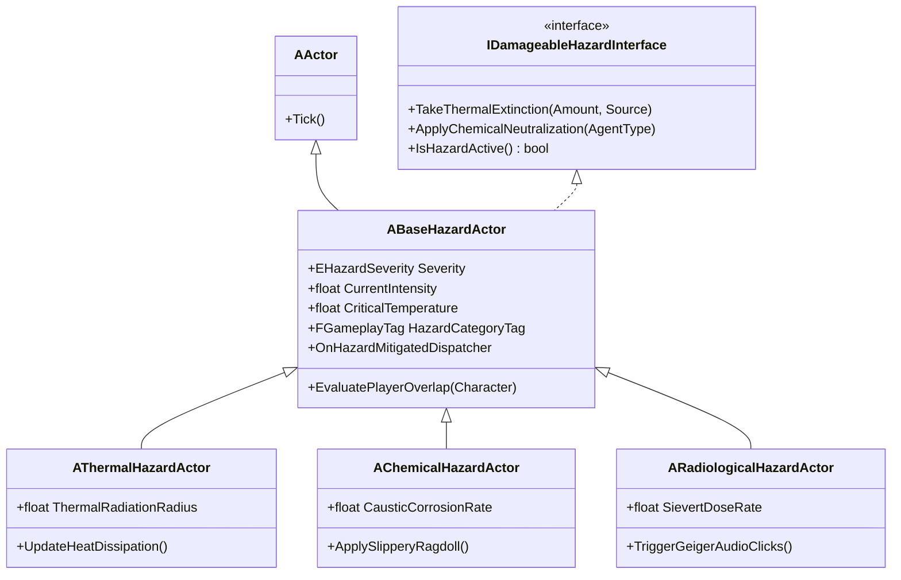

# Suite de Peligros Ambientales: 30 Focos Críticos de Emergencia
## Astra Hazard - Rescue Squad // Documentación de Arquitectura Técnica

---

## 1. Propósito y Alcance

En *Astra Hazard - Rescue Squad*, los peligros ambientales no son meros decorados estáticos; son **sistemas dinámicos de simulación física y termodinámica** que amenazan activamente la supervivencia del escuadrón de bomberos, la integridad estructural de la estación y la vida de los civiles.

La **Suite de Peligros Ambientales** comprende **30 activos 3D interactivos (H01 al H30)** diseñados bajo estrictos principios de ingeniería de software, acatando las normas de `GEMINI.md`:
1. **Modelado Procedural 3D de Alta Fidelidad:** Desarrollados en Blender 5.2 LTS con micro-detalles mecánicos verosímiles (bridas, pernos de latón, soldaduras, medidores de presión, relés, células de carga, cableado trenzado y mallas antideslizantes).
2. **Estilo Comic / Industrial (Cel-Shading):** Trazado de contornos Freestyle en negro azabache (1.4 a 2.4 px), iluminación de estudio balanceada, materiales PBR estilizados y control de emisividad para evitar burnout blanco.
3. **Cero Tolerancia a Primitivas Básicas:** Todos los modelos presentan geometrías complejas, biseles mecánicos y piezas funcionales articuladas o fracturadas.
4. **Lámina Maestra 2.5K Consolidada:** Registro fotográfico verificado a $2560 \times 1600$ píxeles (`Showcase_Peligros_Ambientales_30_Master.png`).

---

## 2. Clasificación Sistemática de los 30 Peligros (5 Lotes de 6)

```
PELIGROS AMBIENTALES (30 ACTIVOS)
├── LOTE 1: Térmicos e Ígneos (H01 - H06) [Rojo / Naranja]
├── LOTE 2: Presión, Fugas & Fluidos Críticos (H07 - H12) [Azul / Cian]
├── LOTE 3: Eléctricos, Arcos & Energía (H13 - H18) [Amarillo Hazard]
├── LOTE 4: Colapsos Estructurales & Escombros (H19 - H24) [Gris / Óxido]
└── LOTE 5: Biológicos, Tóxicos & Radiológicos (H25 - H30) [Verde Lima / Violeta]
```

### 2.1. Lote 1: Peligros Térmicos e Ígneos (H01 a H06)
- **H01 - Ruptura Ígnea de Mamparo (`H01_Fire_Bulkhead_Rupture`):** Placa de mamparo rasgada por soplete térmico con núcleo al rojo vivo ($850^\circ\text{C}$), marcos fundidos y emisión de llamas y humo denso. Mitigación mediante manguera Hydra o extintor criogénico.
- **H02 - Caja de Arco Eléctrico en Llamas (`H02_Electrical_Arc_Fire_Box`):** Gabinete mural con chispas de arco voltaico de alta tensión y combustión de aislantes plásticos. Requiere corte de energía previo antes de aplicar agente extintor conductor.
- **H03 - Foco Químico de Magnesio (`H03_Magnesium_Chemical_Fire`):** Combustión blanca hiperbólica de aleaciones ligeras a más de $2000^\circ\text{C}$. Reactivo al agua (explosión violenta por generación de hidrógeno); exige espuma química retardante (`A осторожно FoamLauncher`).
- **H04 - Brecha en Tobera de Plasma (`H04_Plasma_Nozzle_Breach`):** Inyector de plasma agrietado con chorro direccional supersónico ionizado en cian/violeta. Provoca retroceso físico y daño térmico instantáneo.
- **H05 - Columna Ígnea de Conducto (`H05_Vent_Duct_Inferno`):** Conducto de ventilación horizontal en llamas con aspas de turbina al rojo; bloquea rutas de escape alternativas para el civil o la mascota hexápoda.
- **H06 - Ignición Súbita de Hábitat / Flashover (`H06_Habitation_Flashover`):** Camarote en estado post-flashover con mobiliario calcinado, gases supercalentados en el techo y riesgo de explosión por entrada de oxígeno fresco (Backdraft).

### 2.2. Lote 2: Presión, Fugas & Fluidos Críticos (H07 a H12)
- **H07 - Chorro de Vapor Supercalentado (`H07_Superheated_Steam_Jet`):** Tubería de vapor a 180 Bar con junta rota; emite un chorro invisible a simple vista pero letal a $320^\circ\text{C}$, requiriendo escaneo térmico en visor HUD para su detección.
- **H08 - Derrame de Aceite Hidráulico Resbaladizo (`H08_Hydraulic_Oil_Slick`):** Charco viscoso sobre chapa lagrimada con bomba rota; genera pérdida total de tracción y desencadena ragdoll por resbalón (`EvaluateStumbleRoll`).
- **H09 - Charco Cáustico de Ácido Fluorhídrico (`H09_Hydrofluoric_Acid_Puddle`):** Fuga química de color verde lima burbujeante que corroe el blindaje de las botas del traje espacial y descompone materiales orgánicos.
- **H10 - Fuga Criogénica de Nitrógeno Líquido (`H10_Liquid_Nitrogen_Cryo_Leak`):** Dewar fracturado que vierte nitrógeno a $-196^\circ\text{C}$, congelando instantáneamente el suelo y provocando fragilidad estructural catastrófica.
- **H11 - Vórtice de Descompresión por Brecha en Casco (`H11_Hull_Decompression_Vortex`):** Fisura en el casco exterior con fuerza de succión barométrica que arrastra escombros, herramientas y jugadores hacia el vacío espacial.
- **H12 - Inundación por Refrigerante Tóxico (`H12_Toxic_Coolant_Flooding`):** Sala de bombas anegada por refrigerante azulado a nivel de rodilla, reduciendo la velocidad de marcha y conduciendo electricidad si cae un cable activo.

### 2.3. Lote 3: Eléctricos, Arcos & Energía Descontrolada (H13 a H18)
- **H13 - Cable Látigo de Alta Tensión Suelto (`H13_Live_Arcing_Whip_Cable`):** Conductor de 10 kV oscilante por fuerzas electromagnéticas que azota el suelo con arcos eléctricos intermitentes letales.
- **H14 - Fusión de Generador Auxiliar (`H14_Aux_Generator_Meltdown`):** Rotor desbocado con cojinetes gripados, aspas salientes y riesgo inminente de explosión por sobrevelocidad mecánica.
- **H15 - Rejilla Tramex Electrificada (`H15_Electrified_Floor_Grating`):** Suelo técnico electrificado por derivación a masa; incapacita temporalmente el sistema motor del traje de rescate.
- **H16 - Embalamiento Térmico de Baterías (`H16_Battery_Rack_Thermal_Runaway`):** Celda de litio-grafeno hinchada con emisión de gases inflamables y eyección de fuego en chorro.
- **H17 - Electroimán de Desguace Descontrolado (`H17_Rogue_Scraping_Electromagnet`):** Electroimán de grúa activo que arranca herramientas metálicas de las manos de los jugadores y atrae vigas pesadas.
- **H18 - Banco de Fusibles Reventado (`H18_Blown_High_Amp_Fuse_Bank`):** Armario eléctrico abierto con cartuchos cerámicos estallados y proyecciones de metralla de cobre fundido.

### 2.4. Lote 4: Colapsos Estructurales, Deformación & Escombros (H19 a H24)
- **H19 - Fractura de Viga Maestra en I (`H19_Fractured_Structural_IBeam`):** Viga de soporte principal de 4 metros partida por fatiga térmica, colgando peligrosamente sobre un pasillo principal.
- **H20 - Desprendimiento de Deflector de Techo (`H20_Collapsed_Ceiling_Baffle`):** Panel acústico y térmico de techo suspendido de cables cortados, listo para desplomarse al paso del escuadrón.
- **H21 - Mamparo Deformado por Sobrepresión (`H21_Overpressured_Bulging_Bulkhead`):** Placa de acero abombada hacia el exterior con soldaduras gimiendo; indica una sala colindante bajo 10 atmósferas de presión.
- **H22 - Tramo de Pasarela Metálica Partida (`H22_Broken_Catwalk_Section`):** Barandilla retorcida y tramo de rejilla colgante sobre un abismo de maquinaria, obligando al uso de arneses o salto de precisión.
- **H23 - Compuerta Guillotina Trabada en Ángulo (`H23_Jammed_Blast_Gate_Angle`):** Puerta cortafuegos descendida a media altura en ángulo oblicuo; requiere gato hidráulico de 15T para elevarla.
- **H24 - Colapso de Escala de Gato Enjaulada (`H24_Twisted_Cage_Ladder_Collapse`):** Escalera vertical de acceso a cubiertas superiores aplastada y deformada por caída de escombros.

### 2.5. Lote 5: Biológicos, Tóxicos & Radiológicos (H25 a H30)
- **H25 - Incubadora BSL-4 Estallada (`H25_Shattered_BSL4_Incubator`):** Vitrina de bioseguridad nivel 4 rota con cristales ensangrentados, atmósfera presurizada contaminada y restos de cultivo viral mutágeno.
- **H26 - Cesta de Barras de Combustible Expuesta (`H26_Exposed_Fuel_Rod_Basket`):** Núcleo de reactor dañado con barras de óxido de uranio brillantes en azul Cherenkov; emite radiación gamma ionizante letal por proximidad.
- **H27 - Válvula Bloqueada por Biomasa/Mucílago (`H27_Slime_Clogged_Valve`):** Volante de corte invadido por zarcillos biológicos y esporas que impiden su rotación manual hasta quemar la masa.
- **H28 - Pozo de Sentina Tóxica Desbordado (`H28_Overflowing_Toxic_Sump`):** Sumidero industrial rebosante de lodo químico corrosivo que emana vapores asfixiantes.
- **H29 - Contenedor Dewar Criogénico Destruido (`H29_Shattered_Cryo_Dewar`):** Cilindro de doble pared reventado con hielo de dióxido de carbono y niebla densa que reduce la visibilidad a cero.
- **H30 - Depurador Atmosférico Colonizado por Hongos (`H30_Fungal_Colonized_Scrubber`):** Filtro de aireación vital infestado de esporas fúngicas que envenena la red de oxígeno de la cubierta si no se aísla.

---

## 3. Contratos de Código e Integración en Unreal Engine 5

Todos los peligros ambientales heredan de la jerarquía desacoplada de `ABaseHazardActor`:



### Métodos Clave:
- `TakeThermalExtinction(float Amount, AActor* Source)`: Reduce la temperatura crítica del foco de peligro cuando es rociado por mangueras o extintores de CO2.
- `ApplyChemicalNeutralization(FGameplayTag AgentType)`: Neutraliza fluidos cáusticos o biológicos mediante agentes químicos específicos (espuma clase B/D).
- `IsHazardActive()`: Devuelve `true` mientras la intensidad sea superior al umbral de seguridad, manteniendo activas las partículas Niagara y emisores térmicos.

---

## 4. Lámina Maestra de Peligros Ambientales (`Showcase_Peligros_Ambientales_30_Master.png`)

- **Ubicación:** `Art/Renders/Showcase_Peligros_Ambientales_30_Master.png`
- **Dimensiones:** $2560 \times 1600$ píxeles.
- **Contenido:** Matriz de 5 filas x 6 columnas con los 30 peligros catalogados por códigos de color temáticos, badges de peligrosidad, nombres de archivo 3D oficiales y sellos de certificación de ingeniería.

---

## 5. Pipeline de Exportación FBX y Colisiones UCX

### 5.1. Propósito y Alcance
El script [`Art/Blender/exportar_30_peligros_fbx.py`](file:///F:/Dev/Game/Art/Blender/exportar_30_peligros_fbx.py) automatiza la extracción determinista de los 30 modelos procedurales creados a lo largo de los 5 archivos `.blend` maestros (`Peligros_Lote1_Termicos.blend` a `Peligros_Lote5_Biologicos.blend`) hacia archivos FBX estandarizados independientes en `Art/FBX/Hazards/`.

### 5.2. Contratos y Transformaciones Geométricas
1. **Centrado en Origen y Base en el Suelo:**
   - Se calcula el bounding box en coordenadas de mundo del activo: $(\text{min}_x, \text{max}_x, \text{min}_y, \text{max}_y, \text{min}_z, \text{max}_z)$.
   - Se desplazan todos los vértices por $(-\text{center}_x, -\text{center}_y, -\text{min}_z)$ de modo que el pivote de la malla estática quede exactamente en el punto de apoyo inferior $(0, 0, 0)$.
2. **Jerarquías Compuestas Unificadas:**
   - Cada peligro compuesto por múltiples submallas (focos, toberas, gabinetes, tuberías, marcos de soporte) es duplicado y unido preservando los slots de material PBR per-face.
3. **Generación de Volúmenes de Colisión `UCX_`:**
   - Por cada modelo `SM_Hxx_<Nombre>`, se genera una malla convexa de colisión simplificada con el prefijo `UCX_SM_Hxx_<Nombre>_01`.
4. **Configuración del Exportador FBX:**
   - `apply_unit_scale=True`, `apply_scale_options='FBX_SCALE_ALL'`, `axis_forward='-Z'`, `axis_up='Y'`, `mesh_smooth_type='FACE'`.

---

## 6. Pipeline de Importación Oficial en Unreal Engine 5.8

El script [`Scripts/importar_30_peligros_ue5.py`](file:///F:/Dev/Game/Scripts/importar_30_peligros_ue5.py) procesa de forma desatendida en el motor:
- **Destino en Content Browser:** `/Game/Meshes/Environment/Hazards/` (30 Static Meshes `.uasset`).
- **Configuración de Malla:** Habilitación de Nanite (`build_nanite = True`), detección automática de colisión convexa UCX (`one_convex_hull_per_ucx = True`), importación de materiales PBR.
- **Resultado:** `30/30 Peligros Static Meshes importados con éxito (0 fallos)`.

---

## 7. Clases C++ y Blueprints de Gameplay

### 7.1. Nuevas Clases C++ Especializadas
- [`AElectricalHazardActor`](file:///F:/Dev/Game/Source/AstraHazard/Public/Hazards/ElectricalHazardActor.h): Modela los focos eléctricos del Lote 3 (H13-H18). Calcula daño por arco voltaico en función de tensión e inversa cuadrática de distancia (`CalculateArcShockDamage`) y frecuencia de descarga (`EvaluateArcDischarge`). Permite corte de energía por disyuntor (`SetPowerCut`).
- [`ABiologicalHazardActor`](file:///F:/Dev/Game/Source/AstraHazard/Public/Hazards/BiologicalHazardActor.h): Modela los patógenos y radiación del Lote 5 (H25-H30). Calcula daño por exposición a esporas con factor de atenuación del 80% si el traje espacial está sellado (`CalculateSporeExposureDamage`) y purga por temperatura extrema (`EvaluateBiologicalDecontamination`, `ApplyThermalPurge`).

### 7.2. Catálogo de Blueprints en Content Browser
Ubicación: `/Game/Blueprints/Environment/Hazards/`

| Blueprint Asset | Clase C++ Padre | Malla Estática CDO | Rol de Gameplay |
| :--- | :--- | :--- | :--- |
| [`BP_Hazard_FireBulkhead`](file:///F:/Dev/Game/Content/Blueprints/Environment/Hazards/BP_Hazard_FireBulkhead.uasset) | `AFireHazardActor` | `SM_H01_Fire_Bulkhead_Rupture` | Foco ígneo con radiación térmica y mitigación por agua/espuma |
| [`BP_Hazard_SteamLeak`](file:///F:/Dev/Game/Content/Blueprints/Environment/Hazards/BP_Hazard_SteamLeak.uasset) | `APipeLeakHazardActor` | `SM_H07_Superheated_Steam_Jet` | Chorro invisible a 280°C con empuje de vapor y mitigación por válvula |
| [`BP_Hazard_AcidPuddle`](file:///F:/Dev/Game/Content/Blueprints/Environment/Hazards/BP_Hazard_AcidPuddle.uasset) | `AAcidPuddleHazardActor` | `SM_H09_Hydrofluoric_Acid_Puddle` | Charco cáustico corrosivo y resbalón en Ragdoll neutralizable |
| [`BP_Hazard_VacuumBreach`](file:///F:/Dev/Game/Content/Blueprints/Environment/Hazards/BP_Hazard_VacuumBreach.uasset) | `AVacuumBreachHazardActor` | `SM_H11_Hull_Decompression_Vortex` | Vórtice de succión barométrica y sellado por soldadura/parches |
| [`BP_Hazard_ElectricalArc`](file:///F:/Dev/Game/Content/Blueprints/Environment/Hazards/BP_Hazard_ElectricalArc.uasset) | `AElectricalHazardActor` | `SM_H13_Live_Arcing_Whip_Cable` | Cable látigo de 10 kV con arcos intermitentes y aturdimiento |
| [`BP_Hazard_StructuralCollapse`](file:///F:/Dev/Game/Content/Blueprints/Environment/Hazards/BP_Hazard_StructuralCollapse.uasset) | `AStructuralCollapseHazardActor` | `SM_H19_Fractured_Structural_IBeam` | Viga en I bajo tensión crítica con fractura física Chaos |
| [`BP_Hazard_BiologicalSpore`](file:///F:/Dev/Game/Content/Blueprints/Environment/Hazards/BP_Hazard_BiologicalSpore.uasset) | `ABiologicalHazardActor` | `SM_H25_Shattered_BSL4_Incubator` | Nube de esporas tóxicas con purga térmica o lavado químico |

---

## 8. Nivel Showroom: `Gym_Hazards_Showcase.umap`

- **Ubicación:** `Content/Maps/Gym_Hazards_Showcase.umap`
- **Diseño Arquitectónico:**
  - Pabellón con 48 baldosas modulares de suelo (`SM_Floor_Plate_400x400` y `SM_Floor_MetalGrid_400x400`).
  - 5 avenidas temáticas escalonadas en $Y \in \{0, 500, 1000, 1500, 2000\}\,\text{cm}$.
  - 6 focos por avenida distribuidos en $X \in \{-750, -450, -150, 150, 450, 750\}\,\text{cm}$.
  - Instanciación activa de los Blueprints interactivos principales y mallas estáticas complementarias.
  - `PlayerStart` frontal orientado hacia el pabellón ($0, -350, 50$) con iluminación dinámica Lumen (`DirectionalLight` y `SkyLight`).

---

## 9. Verificación por Automatización (Automation Testing)

- **Test:** `AstraHazard.Hazards.EnvironmentalHazardsSuiteValidation`
- **Archivo:** [`Source/AstraHazard/Private/Tests/AstraCoreAutomationTests.cpp`](file:///F:/Dev/Game/Source/AstraHazard/Private/Tests/AstraCoreAutomationTests.cpp#L1500-L1550)
- **Resultados de Validación:**
  - `Daño de arco eléctrico a distancia 0 debe ser 50`: **PASS**
  - `Daño de arco al borde y fuera del radio debe ser 0`: **PASS**
  - `Disparo intermitente por intervalo de 2.0s`: **PASS**
  - `Daño de esporas sin traje sellado (35) vs con traje sellado (7)`: **PASS**
  - `Factor de protección hermética del 80%`: **PASS**
  - `Purga biológica térmica efectiva (>350°C)`: **PASS**
- **Resultado Global:** `Test Completed. Result={Success} Name={EnvironmentalHazardsSuiteValidation}` (100% de éxito).

---

## 10. Reparación de Componentes Visuales en Blueprints y C++ (UE 5.8)

Para eliminar Blueprints invisibles o con fallos de jerarquía detectados en auditorías de nivel, se corrigieron los constructores nativos y los Subobjects de Blueprint mediante [`Scripts/reparar_blueprints_peligros_y_amenazas_ue5.py`](file:///f:/Dev/Game/Scripts/reparar_blueprints_peligros_y_amenazas_ue5.py):
- **`StructuralCollapseHazardActor.cpp` (`BP_Hazard_StructuralCollapse`):** Se vinculó `HazardAreaSphere->SetupAttachment(RootComponent)` en C++ y se asignó `SM_H19_Fractured_Structural_IBeam` a `BeamMeshComponent`.
- **`BiologicalHazardActor.cpp` (`BP_Hazard_BiologicalSpore`):** Se ajustó `HazardMeshComponent` a `EComponentMobility::Movable` en C++ (erradicando conflictos de movilidad `AttachTo` respecto a `HazardAreaSphere`) y se asignó `SM_H25_Shattered_BSL4_Incubator`.
- **`BP_Hazard_AcidPuddle`:** Se añadió el subobjeto `AcidPuddleMesh` (`UStaticMeshComponent`) con `SM_H09_Hydrofluoric_Acid_Puddle` en `/Game/Blueprints/Environment/Hazards/`.
- **Amenazas y Ventilación:** Se añadieron/restauraron `ThreatMesh` en `BP_Threat_01_Werewolf` (`SM_Bestiary_01_Werewolf`, Z relativa `-96.0`) y `BP_Threat_03_Scrapper` (`SM_Bestiary_03_Scrapper`, escala `0.70`, Z relativa `-96.0`), y `RotorMesh` (`SM_Mod_29_Deco_Wall_Sconce_Fan`) en `BP_ExhaustTurbineFan`.

